# Week 7 — Terraform, Checkov and Wazuh IaC Security

This lab brings Terraform security findings into the existing SOC monitoring environment. Checkov detected intentionally world-open SSH ingress, failed findings were normalized into one JSON event per line and collected by Wazuh, and the selected SSH policy was remediated in source. The final focused `CKV_AWS_24` scan passed **1 / failed 0 / skipped 0** after changing the ingress CIDR to `10.7.0.0/16`. Other findings remained.

This folder is the Week 7 portfolio record alongside Weeks 1–6 in `MN-young/security-engineering-mentorship-labs`. The existing standalone lab repository stays unchanged. The documentation and selected screenshots were reviewed and approved for this mentorship portfolio. See the [evidence catalog](evidence/README.md).

## Objective and architecture

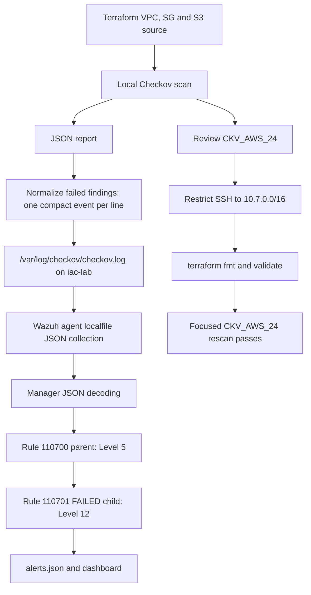

The completed ingestion path ran locally on `iac-lab`. A separate GitHub Actions stretch workflow ran Checkov and failed on remaining findings. It is documented separately from the local Wazuh path. See [architecture](architecture/README.md).

## Lab environment

Windows host, VMware and Ubuntu VMs; PowerShell SSH sessions to `iac-lab` and the existing Wazuh manager. Original readiness evidence shows Terraform **1.16.4** on Linux and Checkov **3.3.22**. Existing Week 6 rules were preserved.

[Original lab tool versions](evidence/environment/017-2026-10-02-125901.png)

The earlier handoff's independent macOS validation used Terraform 1.6.6 and AWS provider 6.68.0. Those values describe prepared reference files, not the original VM toolchain. [Setup and provenance](documentation/setup.md) explains the distinction.

## Terraform baseline and Checkov detection

The baseline declared `aws_vpc.week7_vpc`, `aws_security_group.week7_sg` and `aws_s3_bucket.week7_bucket`. The intentional SSH weakness was TCP/22 ingress from `0.0.0.0/0`.

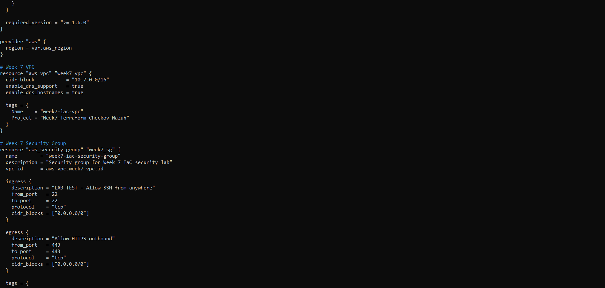

_Intentional baseline: TCP/22 ingress from `0.0.0.0/0`; outbound HTTPS is a separate declaration._

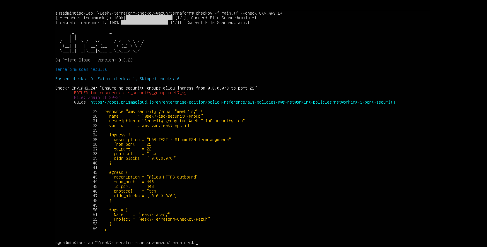

_Focused scan: 0 passed, 1 failed, 0 skipped on `aws_security_group.week7_sg`. The source excerpt visibly permits SSH from all IPv4 addresses._

The broader original scan checkpoint directly shows **10 passed / 11 failed / 0 skipped**. S3/VPC findings included `CKV_AWS_18`, `CKV_AWS_144`, `CKV2_AWS_61` and `CKV_AWS_21`. Counts belong to their checkpoint; they do not describe the focused scan or a later complete security assessment.

Terraform init and validation succeeded after syntax repair. A successful plan reported **3 to add, 0 to change, 0 to destroy**. That establishes a plan only; an apply or AWS deployment is not confirmed.

## JSON export and normalization

Terminal output did not automatically create a report. JSON was explicitly exported, and `results.failed_checks` was transformed into compact records appended to `/var/log/checkov/checkov.log`.

```text
Early schema: source=checkov / event_type=iac_misconfiguration / status=FAILED
Final schema: integration=checkov / check_id / check_name / resource / file_path / result=FAILED
```

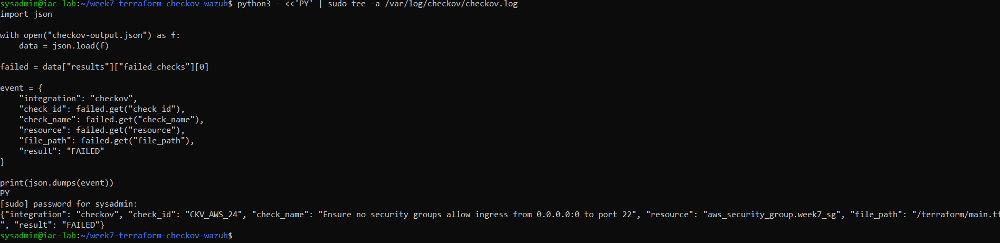

_An actual `week7_sg` Checkov finding is normalized and appended; the displayed password prompt contains no password._

The final manager rules match `integration` and `result`. The raw multi-line report and early field names must not be treated as the final collector input. See [Checkov to Wazuh](documentation/checkov-to-wazuh.md).

## Wazuh correlation and analyst visibility

The agent's localfile block used JSON format and the exact Checkov log path. Initial JSON decoding fell through to generic Rule `1002`; matching and group placement were corrected. The manager configuration test exited successfully despite unrelated CDB/malicious-IOC warnings. Final logtest reached Rule **110701**, Level **12**, with `Alert to be generated.`

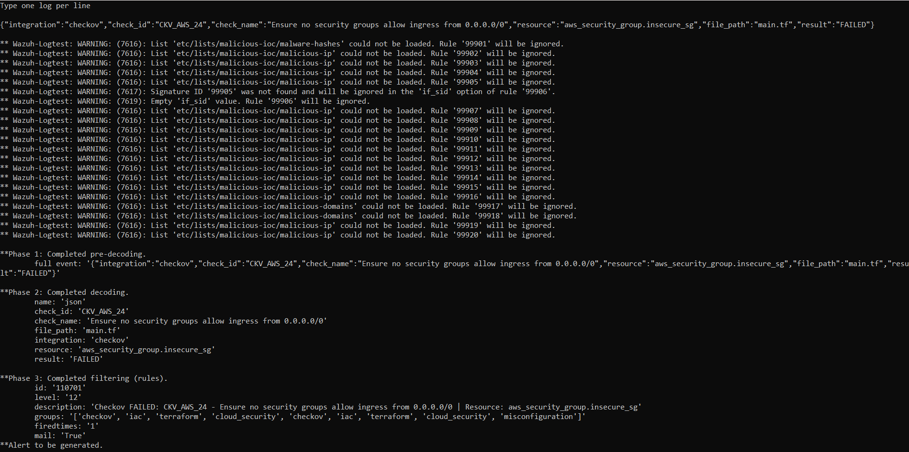

_Synthetic test event: `insecure_sg`, Rule 110701, Level 12 and `Alert to be generated`. Logtest verifies manager decoding/matching; live transport is a separate check._

A manual `aws_security_group.insecure_sg` event first proved transport and matching. Real scanner findings used `aws_security_group.week7_sg` and other actual resources. These stages are distinct.

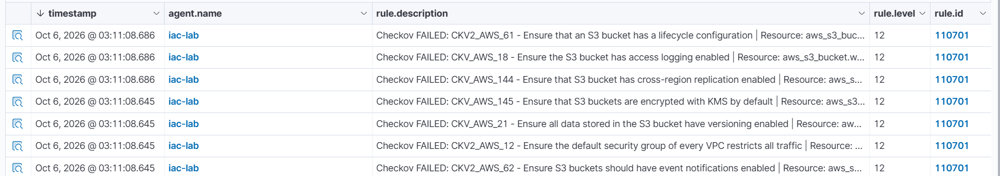

_The list visibly shows multiple failed S3/VPC controls at Rule 110701, Level 12._

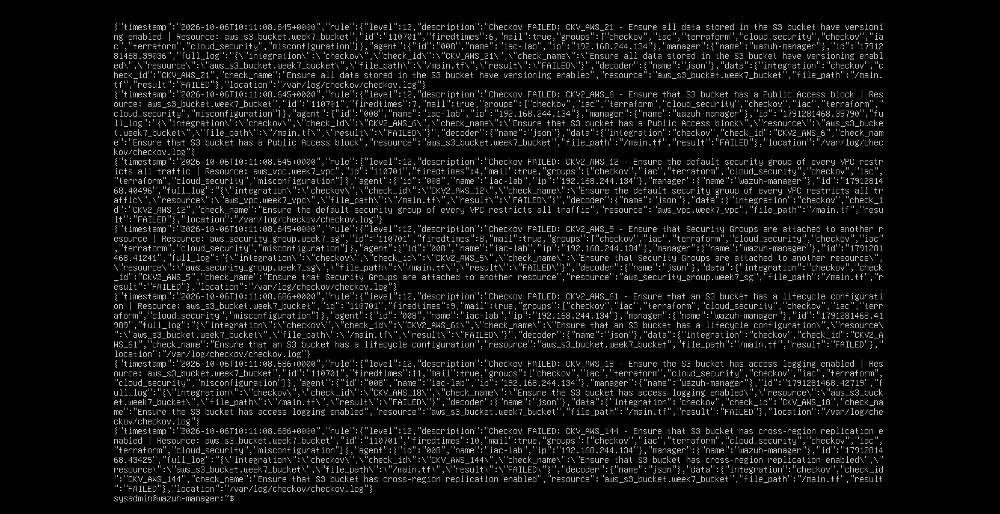

_Real S3/VPC/security-group findings in `alerts.json`, classified by Rule 110701 at Level 12 for `iac-lab`._

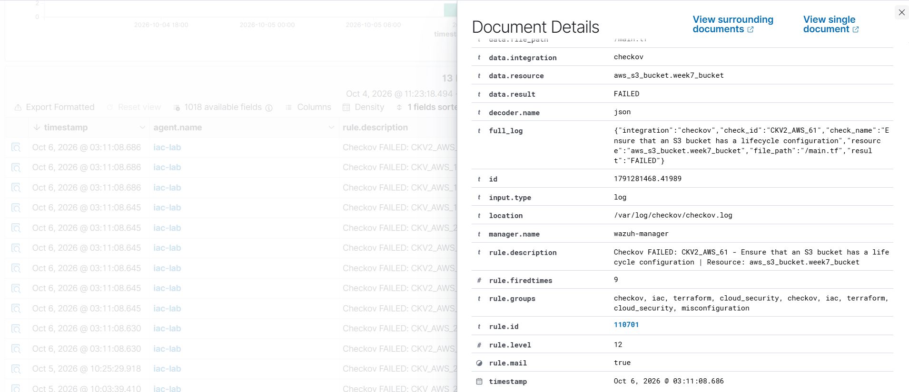

_Indexed S3 lifecycle finding: `CKV2_AWS_61`, `aws_s3_bucket.week7_bucket`, `integration=checkov`, `result=FAILED`, JSON decoder and `/var/log/checkov/checkov.log`. This scrolled panel visibly includes Rule 110701 and Level 12. It is not SSH-pass evidence; [the complementary field view](evidence/wazuh/082-2026-10-06-112401.png) identifies the S3 check and resource._

The synthetic test and real scanner records are labeled separately in the [integration guide](documentation/checkov-to-wazuh.md).

## Local scan and forwarding automation

The corrected historical `run-checkov-wazuh.sh` changed into `/home/sysadmin/week7-terraform-checkov-wazuh/terraform`, exported `../checkov-output.json`, iterated failed checks and appended JSON events to the monitored log. Script output, manager acceptance and dashboard visibility were checked separately.

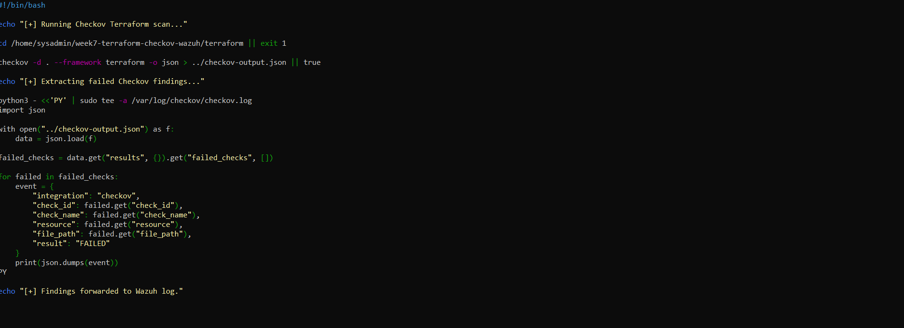

_Final recorded script design: explicit Terraform directory and matching report paths._

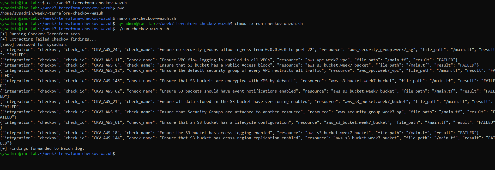

_Local script execution prints multiple actual failed findings and appends them to the Wazuh-monitored log._

[Historical reconstruction](scripts/run-checkov-wazuh-historical.sh) preserves the manual's design, including `|| true` and its limited error handling. The [reference runner](scripts/run-checkov-wazuh.sh) and [strict normalizer](scripts/normalize-checkov.py) are earlier handoff improvements, not recovered VM exports or new changes installed on the lab.

## Task 42 — Selected SSH remediation

SSH ingress changed from `0.0.0.0/0` to `10.7.0.0/16`. Its description was updated to restrict SSH to the lab VPC. The original screenshot spells the description `lap VPC`; the prepared reference corrects that typo explicitly.

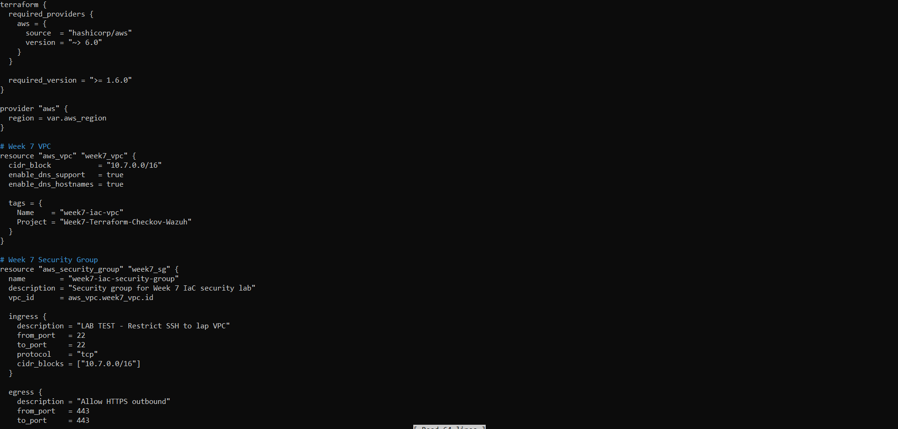

_Corrected source: SSH restricted to `10.7.0.0/16`; the selected screenshot remains unmodified._

[Original formatting and validation output](evidence/remediation/087-2026-10-10-193324.png) directly confirms success after the change. The focused rescan supplies direct pass evidence:

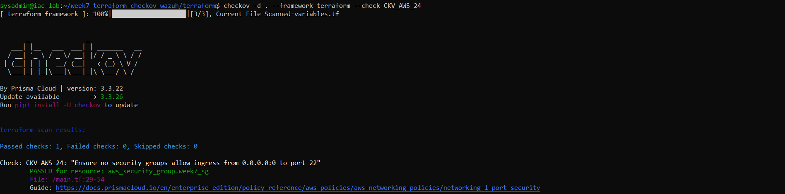

## Task 43 — Before/after and control comparison

| Selected measure | Before | After |
| --- | --- | --- |
| SSH IPv4 ingress | `0.0.0.0/0` | `10.7.0.0/16` |
| CKV_AWS_24 | Failed | Passed |
| Focused passed / failed / skipped | 0 / 1 / 0 | 1 / 0 / 0 |
| Full configuration secure | Not established | Not established; other findings remain |

The manual also frames Task 43 as preventive Checkov scanning versus Wazuh/Suricata runtime detection. Both the [remediation comparison](documentation/remediation.md) and [control comparison](documentation/task-43-comparison.md) are retained. Wazuh centralized supplied findings; it did not independently inspect AWS or demonstrate exploitation.

## GitHub Actions stretch attempt

The historical standalone workflow triggered on Terraform/workflow changes, installed Checkov and ran `checkov -d terraform --framework terraform`. It executed and failed on security findings.

[CI failure summary and runner notices](evidence/github-actions/100-2026-10-10-220916.png)

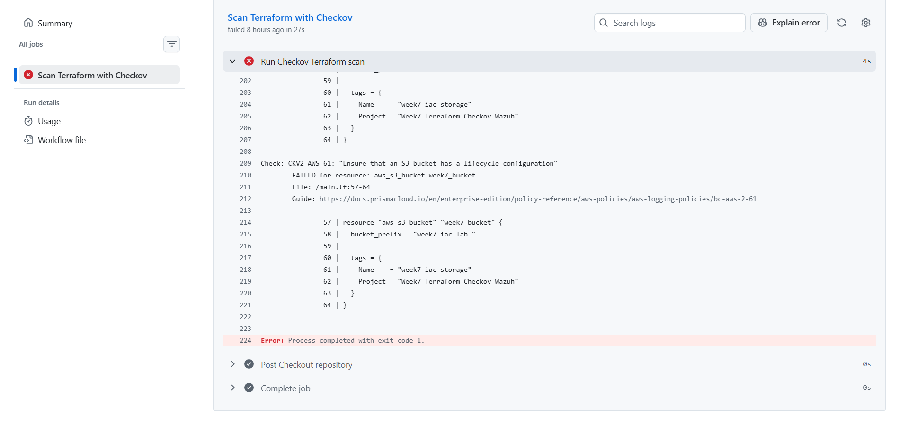

_Expanded CI output shows an S3 lifecycle failure and exit code 1. Node.js/runner notices are environment annotations, not the reason the security job failed._

This evidence updates the older manual's unverified-execution status. It does not prove automatic GitHub Actions-to-Wazuh delivery. This portfolio record adds no active workflow and changes no standalone source. See [CI stretch](documentation/ci-stretch.md).

## Troubleshooting highlights

Checkov's bad literal-HOME symlink was corrected to the absolute virtual-environment path. DNS failed despite IP connectivity; VMware service restarts and DNS overrides were attempted, then resolver/network state was reverted and DNS queries succeeded. Terraform syntax and expired credentials interrupted readiness. Missing logs, changing report paths, schema mismatches, XML group placement and script launch paths interrupted ingestion.

The [troubleshooting register](documentation/troubleshooting.md) preserves symptoms, attempts, corrections, validations and unresolved causes—including command typos, generic Rule 1002, unrelated warnings and watchdog observations.

## Completion tracker and limitations

| Item | Final known-good state |
| --- | --- |
| Terraform baseline | Initialized, validated and planned; deployment unconfirmed |
| CKV_AWS_24 before | Failed, world-open SSH |
| Local Checkov-to-Wazuh chain | Failed findings collected; Rule 110701 Level 12; manager/dashboard visibility |
| Local automation | Corrected scan/report paths; multiple failures forwarded |
| Task 42 | SSH source corrected; focused scan passes 1 / 0 / 0 |
| Task 43 | Before/after and preventive/runtime comparison documented |
| Remaining IaC findings | Unresolved; S3/VPC controls remain |
| CI stretch | Checkov ran and failed on findings; CI-to-Wazuh unproven |
| GitHub portfolio update | Approved portfolio documentation; 42 screenshots reviewed |

No AWS deployment, fully secure Terraform configuration, complete CI-to-Wazuh automation, new Suricata attack validation or Week 7 Shuffle/Slack delivery is claimed. [Final-state record](validation/final-state.md) separates historical evidence from local handoff checks.

## Evidence gallery

Twelve strongest proof images appear above. [The evidence catalog](evidence/README.md) lists the exact 42 selected originals, classifications and captions. Thirty selected images remain in organized supporting/troubleshooting folders, covering readiness, DNS recovery, Terraform repair, credentials, report/log paths, generic-rule fallback and Git hygiene.
