# Architecture and evidence boundaries

The verified path is local Terraform static scanning on `iac-lab`, normalization of failed Checkov findings, Wazuh agent collection, manager rule correlation and dashboard visibility. The Windows host supplied VMware and remote administration sessions. The existing Wazuh manager retained earlier lab rules.

```mermaid
flowchart LR
 A["Terraform source on iac-lab"] --> B["Checkov"]
 B --> C["Raw JSON report"]
 C --> D["Compact JSON lines"]
 D --> E["/var/log/checkov/checkov.log"]
 E --> F["Agent localfile JSON"]
 F --> G["Manager JSON decoder"]
 G --> H["110700 Level 5 parent"]
 H --> I["110701 Level 12 failed child"]
 I --> J["alerts.json"]
 J --> K["Indexed dashboard"]
```

`run-checkov-wazuh.sh` automated the local scan, export, transformation and append stages. The historical parent matches `integration=checkov`; its child matches `result=FAILED`. The child applies to Checkov failures generally, so S3 and VPC alerts are expected. Level 12 is the Wazuh lab classification, not a Checkov vendor severity value.

| Verification | What it establishes | What it does not establish |
| --- | --- | --- |
| Terraform init/validate | Provider readiness and valid configuration | AWS deployment or security certification |
| Terraform plan | Proposed creation of 3 resources | Apply or resources created |
| Focused CKV_AWS_24 scan | Selected SSH policy result | Clean full scan |
| Manager logtest | Decoding and rule matching for submitted input | Agent transport or indexing |
| Agent collector log | Configured file is analyzed | Manager acceptance by itself |
| Live alerts.json | Collected events classified by manager | Dashboard indexing by itself |
| Dashboard document | Indexed finding visible to analyst | Independent AWS inspection or exploitation |

The separate historical GitHub Actions path ended in Checkov findings and exit code 1. Its automatic delivery into Wazuh is unproven. No cloud deployment or new SOAR route is part of this documented architecture.

The source correction changes only inbound SSH CIDR. Outbound HTTPS still uses `0.0.0.0/0`; that separate egress declaration was not the selected finding. Remaining S3/VPC policies need correction or disposition individually.
