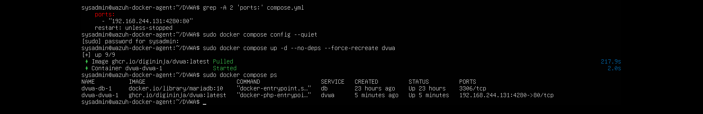
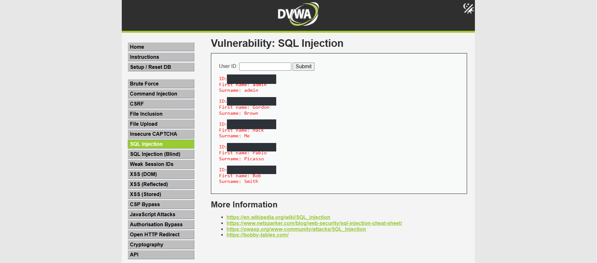
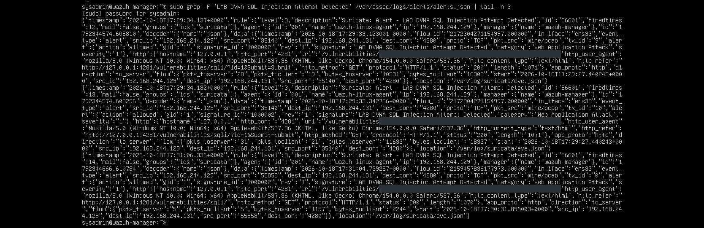
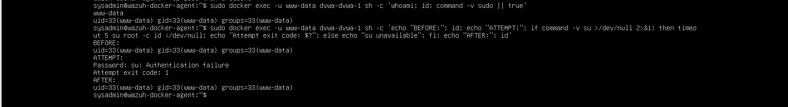
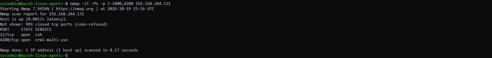
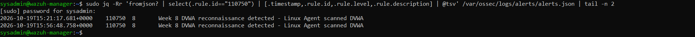
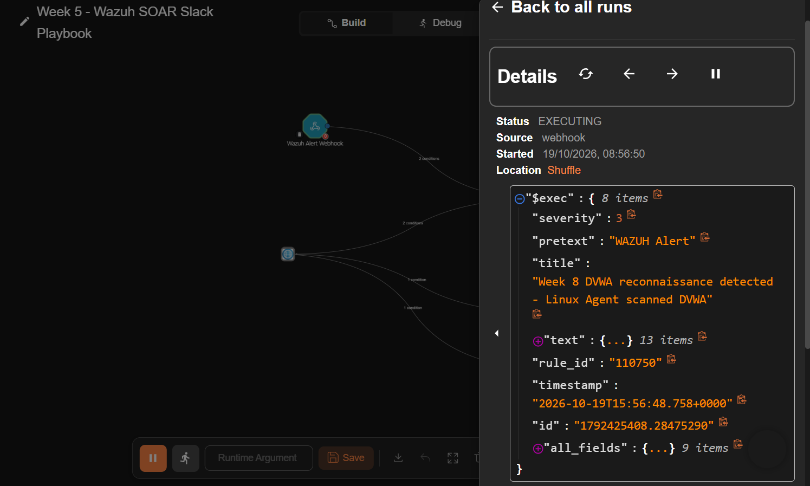
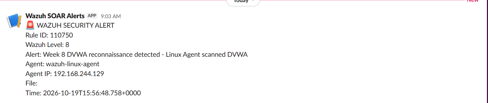
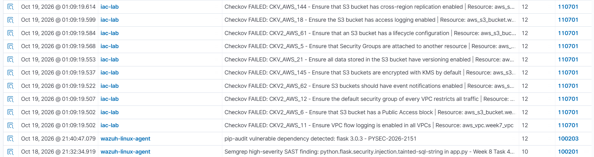
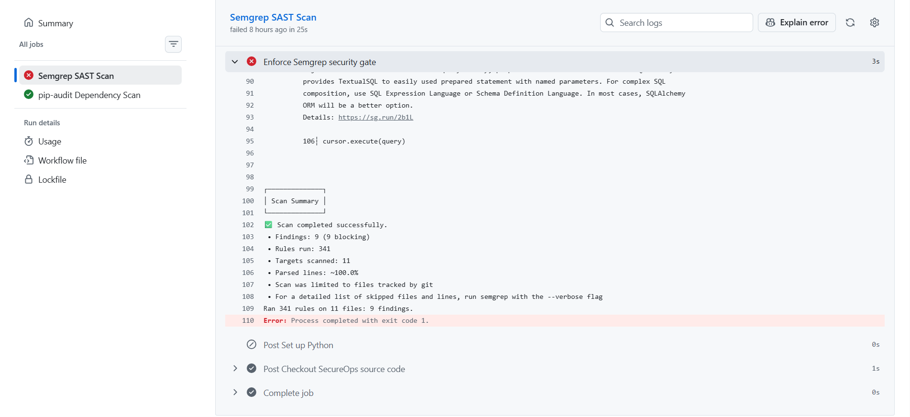

# Week 8 — Final SOC Integration and End-to-End Security Monitoring

I brought my earlier security engineering labs together around an intentionally vulnerable DVWA application. I deployed the application in Docker, tested reconnaissance and SQL injection, investigated detection and delivery failures, and rechecked my AppSec and IaC integrations against the central Wazuh manager.

The strongest complete notification path is **Nmap → Suricata → Wazuh Rule 110750 → Shuffle → Slack**. The evidence also establishes a successful SQL injection demonstration and SQLi detection in Suricata/Wazuh. The attempted privilege escalation remained unsuccessful as `www-data`. Fresh Week 8 TheHive case creation and Cortex enrichment were not verified because of the reported licensing limitation and the observed Cortex server quota.

This portfolio records the October 15–19, 2026 lab evidence. The documentation and sanitized copies were prepared for review on October 22, 2026. No new attacks, scanner runs or changes to the live lab were performed during portfolio preparation.

## Read this project

- [Architecture and original diagram](architecture/README.md)
- [Original Task 48 architecture overview](documentation/task-48-architecture-overview.docx)
- [Original revised Task 49 runbook](documentation/task-49-incident-response-runbook.docx)
- [Technical chronology and command explanations](documentation/technical-chronology.md)
- [Detection logic and matching](documentation/detection-engineering.md)
- [Troubleshooting register](documentation/troubleshooting.md)
- [DVWA reconnaissance incident response runbook](documentation/incident-response-runbook.md)
- [Task 44–50 status and final results](validation/final-results.md)
- [Evidence catalog and all 71 source decisions](evidence/README.md)
- [Actual screenshot gallery](evidence/gallery.md)
- [DVWA deployment and database evidence](documentation/dvwa-deployment.md)

## Lab environment and objectives

The lab ran on VMware Workstation with Ubuntu VMs and a Windows host. Earlier work used a Windows agent as well. DVWA was deliberately vulnerable training material and was exposed only inside the isolated lab. Private subnet addresses are retained because they explain the tested traffic and detection scope; credentials and webhook tokens are concealed in separate publication copies.

| System | Lab address | Week 8 role |
| --- | --- | --- |
| Wazuh Manager | 192.168.244.128 | Central rules, alerts.json and integration dispatch |
| Wazuh Linux Agent | 192.168.244.129 | Nmap source, Suricata ens33 monitoring, AppSec collection |
| Windows Agent | 192.168.244.130 | Earlier endpoint lab; not part of final recon validation |
| Wazuh Docker Agent | 192.168.244.131 | DVWA application and MariaDB containers; TCP/4280 |
| Shuffle SOAR | 192.168.244.132 | Webhook workflow and Slack notification |
| IaC Lab | 192.168.244.134 | Terraform/Checkov findings and Wazuh collection |

The handoff and final Task 48 overview place TheHive/Cortex on the Manager VM, while the October 15 container listing is taken at a Docker Agent prompt and lists those containers there. Their exact Week 8 placement cannot be reconciled from the supplied evidence. The original diagram retains the author’s Manager assignment, and this discrepancy is disclosed in the architecture notes. It does not affect the independently traced recon notification path.

The central tools were Docker/Compose, DVWA/MariaDB, Nmap, Suricata, Wazuh, Shuffle and Slack. Semgrep, pip-audit, GitHub Actions, Terraform and Checkov supplied regression checks. TheHive and Cortex remained relevant to the intended case-management path but did not establish a fresh completed Week 8 workflow.

## Task 44 — Deploying and reaching DVWA

I cloned DVWA and started its Compose services. The first container listing showed `127.0.0.1:4280->80/tcp`, so a working local `curl` did not establish that the Linux Agent could reach it over the VM network. I used SSH forwarding for access during this phase.

I then changed the application binding to `192.168.244.131:4280:80`, checked the Compose configuration and recreated only the DVWA service. I restricted forwarded access to source `192.168.244.129`. The first iptables command failed with `Invalid rule number`; a corrected command and listed DOCKER-USER rule show the later state. This was a lab access control, not a claim of production hardening or persistent firewall configuration.



_E15: Compose configuration checked, DVWA recreated, and lab-IP port binding verified._

The allowed Linux Agent received a redirect at the root path and HTTP 200 from `login.php`. The Windows host could ping the Docker VM but failed its TCP/4280 test. That result is consistent with the source restriction and should not be presented as a failed DVWA deployment. Suricata HTTP events confirmed that the monitored interface could see the relevant application requests. Full setup and networking steps are in the [chronology](documentation/technical-chronology.md).

## Task 45 — SQL injection and privilege escalation attempt

I first queried DVWA with User ID `1` and received one training record. With DVWA security set to Low, a tautological input returned five training records. The change in application response demonstrates SQL injection in this controlled lab. It does not establish database takeover, host compromise or an automatically acquired shell.



_E25: Tautology SQL injection returns five DVWA training records; exploitation of the lab query is demonstrated._

I checked that Suricata loaded its configuration, refined a local HTTP signature and repeated the request. The complete recorded rule uses SID `1000002`, revision `1`, the raw SQLi URI prefix and encoded quote/OR content. `eve.json` then showed `LAB DVWA SQL Injection Attempt Detected`; the manager ingested it under Wazuh Rule `86601`, Level `3`. The alert action was `allowed`: Suricata detected the request rather than blocking it. The selected evidence establishes SQLi → Suricata → Wazuh; a matching SQLi-specific Slack message or fresh TheHive case is not supplied.



_E33: Wazuh alerts.json ingests the SQLi signature as Rule 86601, Level 3; action allowed indicates detection, not blocking._

For the escalation test, I used the operator's existing Docker access to enter `dvwa-dvwa-1` with `docker exec -u www-data`. The first check returned UID/GID `33`; an attempted `su root -c id` failed authentication and returned `1`. The after-check still returned `www-data`. This is a failed escalation test from an explicitly chosen container identity, not evidence of a shell obtained through SQL injection or of a container escape.



_E53: Operator uses docker exec -u www-data; su authentication fails with exit 1 and before/after uid remains 33._

A later broad manager search returned Semgrep and generic `Successful sudo to ROOT executed` records. Those describe separate administrative activity and do not establish successful escalation by `www-data`, nor a correlated detection of its failed `su` attempt. [E60](evidence/privilege-escalation/E60-2026-10-19-154901.png) is retained to make that distinction reviewable.

## Task 46 — Reconnaissance detection and notification

I ran the following against my isolated DVWA host:

```bash
nmap -sT -Pn -p 1-1000,4280 192.168.244.131
```

`-sT` uses TCP connect scanning, `-Pn` skips host discovery, and the port list includes the lower 1,000 ports plus DVWA's published port. The final scan reported SSH/22 and TCP/4280 open. The service label `vrml-multi-use` is Nmap's port-name lookup, not independent application identification; the HTTP and DVWA evidence establishes what was serving on 4280.



_E69: Final Nmap -sT -Pn -p 1-1000,4280 scan; SSH/22 and DVWA/4280 open._

Suricata's `LOCAL TCP Port Scan Detected` signature reached Wazuh through parent Rule `86601`. My first custom Rule `110750` matched `data.src_ip`, `data.dest_ip` and `data.alert.signature`; querying for it returned no rows even though base alerts existed. I corrected the matching fields to `src_ip`, `dest_ip` and `alert.signature`. Wazuh output nests these decoded values under `data` in alerts.json, but the custom rule matches the decoded field names without that wrapper.

The corrected child rule matches only Linux Agent → DVWA with that exact signature and assigns Wazuh Level `8`. [The configuration record](configs/README.md) includes only the complete rule actually visible in the screenshots. The final Task 48 overview reports a configuration test and Manager restart; the screenshots establish the corrected rule and later matches but do not capture the exact reload command. The source overview and E34 also record the Shuffle forwarding threshold of Level 7, so the original Level 3 base alert was below that threshold and the targeted Level 8 match qualified.



_E70: Two custom Rule 110750 Level 8 alerts; final event 15:56:48.758+0000 matches Shuffle and Slack._

Two custom matches are visible: `2026-10-19T15:21:17.681+0000` and `2026-10-19T15:56:48.758+0000`. The latter timestamp and Rule `110750` appear in both the Shuffle payload and Slack notification. This connects detection, integration receipt and analyst notification without relying on their different display clocks.



_E71: Final reconnaissance payload in Shuffle, Rule 110750 and matching timestamp; UI status EXECUTING; extra severity 3 origin unresolved._

The Shuffle screen still says `EXECUTING`; it proves receipt of the matching payload, not terminal completion of every workflow branch. Its additional `severity: 3` value has no conclusively verified origin. The Wazuh alert is Level `8`, and Slack explicitly displays that level. I have not described this as an intentional severity conversion.



_E58: Slack notification matches Rule 110750 Level 8 and final manager event timestamp; destination channel reported by handoff, channel label not visible in crop._

The handoff identifies the destination as `#soc-alerts`; the supplied Slack crop shows the message but not its channel header. Slack delivery is visible, while the channel name is handoff context. Earlier no-route, refusal and timeout errors are retained in the troubleshooting record rather than hidden by the later success.

## Case handling and enrichment limits

TheHive configuration and integration files existed. TheHive status requests returned HTTP 200, but logs also reported a Cortex server quota of zero. A healthy endpoint is not the same as a working case/enrichment integration. The handoff reports a licensing limitation; the quota warning independently supports that this path was limited. No fresh Week 8 case ID, successful case-creation response or completed Cortex analyzer result is available. Prior Week 3 success remains documented in its own folder and is not reused as proof of Week 8 completion.

## Task 47 — AppSec and IaC regression checks

I inspected the Linux Agent's JSON collectors at `/var/log/semgrep/findings.json` and `/var/log/pip-audit/findings.json`. Synthetic `wazuh-logtest` inputs validated matching; separately, appending clearly marked test JSON to those monitored files produced live manager alerts.

| Checkpoint | Observed result | Evidence boundary |
| --- | --- | --- |
| Semgrep logtest and live forwarding | Rule 100201, Level 10 | Controlled test event; not a newly exported scanner finding |
| pip-audit logtest and live forwarding | Rule 100203, Level 12 | Deliberately vulnerable Flask 3.0.3 test payload |
| GitHub Actions rerun | Semgrep 9 findings, 9 blocking; 341 rules, 11 targets; exit 1 | Scanner ran and blocking gate worked |
| pip-audit job in that rerun | Passed | Job-level success; not proof that every dependency is risk-free |
| Checkov findings | Rule 110701, Level 12 in manager and dashboard | Local finding ingestion visible; scan also encountered an API DNS error |



_E54: Dashboard jointly displays Checkov 110701 Level 12, pip-audit 100203 Level 12 and Semgrep 100201 Level 10._

The previous Week 6 final record uses Semgrep Rule `100202` at Level `12`. The Week 8 screenshots instead show `100201` at Level `10`. Both records remain intact; I do not rewrite the older week or claim that a migration explanation is proven. The Week 8 scan's nine findings also belong to a different checkpoint from Week 6's recorded six findings.



_E59: Semgrep CI scan: 9 findings, 9 blocking, 341 rules, 11 targets, exit 1; pip-audit job green._

The live pip-audit test intentionally used a vulnerable version in JSON while the separate CI job passed. These are compatible observations about different checks. Findings were exported/forwarded or manually replayed; automatic GitHub Actions-to-Wazuh delivery is not established.

Checkov printed normalized failures below a `api.prismacloud.io` name-resolution traceback. A Checkov finding reached Rule `110701`, Level `12`, and the dashboard showed multiple Checkov controls. This supports continued ingestion but does not prove a complete, successful fresh Checkov scan. Earlier Week 7 SSH remediation and its focused passing rescan remain in the [Week 7 record](../week-07-terraform-checkov-wazuh/README.md); its CI stretch ran and failed on remaining findings, without proving CI-to-Wazuh automation.

## Tasks 48–50 — Architecture, response and handoff

The [original architecture overview and diagram](architecture/README.md) separate the verified notification path, earlier AppSec/IaC inputs and incomplete case-management branch. The [revised runbook](documentation/incident-response-runbook.md) covers only DVWA reconnaissance in four major sections: Detection, Triage, Containment and Lessons Learned. It explicitly records that I did not block the Linux Agent or shut down DVWA because this was an authorized lab test; response actions for an unknown source are hypothetical procedures.

The final Task 48 Word overview and revised Task 49 Word runbook are included unchanged, with Markdown companions for GitHub reading. The original architecture PNG is extracted directly from the Task 48 document. A final presentation recording has not been supplied. [Task status](validation/final-results.md) records the remaining limitations.

## Troubleshooting and lessons learned

I learned to verify each boundary independently: application reachability, sensor visibility, base decoding, custom matching, webhook transport and analyst receipt. The loopback binding explained why local success did not imply remote access. The wrong field wrapper explained why a valid base event did not fire the custom rule. A successful frontend check did not prove webhook delivery, and a healthy TheHive status endpoint did not overcome the Cortex quota.

Preserving failed attempts made the final result more credible. Configuration tests, synthetic logtests, manually injected events, scanner output and live delivery validate different things. Their timestamps and rule identifiers have to be traced instead of treating every green status or security-labelled record as the same event.

[The troubleshooting register](documentation/troubleshooting.md) keeps command errors, unresolved causes, failed transport attempts, missing integration launcher, Checkov DNS failure, rule correction and false-positive evidence interpretation. [Final results](validation/final-results.md) distinguish verified, failed, limited and unsupported outcomes.

## Evidence and documentation scope

All 71 original PNGs were opened and hash-checked against the supplied manifest; no binary duplicates were found. This portfolio includes 45 distinct captures, with ten embedded in this README and the rest in the supporting catalog. Seven copies contain opaque redactions; the other 38 are byte-identical copies. Original files and the raw archive remain private and unchanged. The [manifest](evidence/evidence-manifest.csv) identifies every original, selected destination, hash and redaction decision.

This Week 8 record preserves the earlier projects and their checkpoint-specific results. The supplied final architecture/runbook Word originals are retained unchanged. No final recording is claimed. Standalone projects and active workflows are unchanged.
