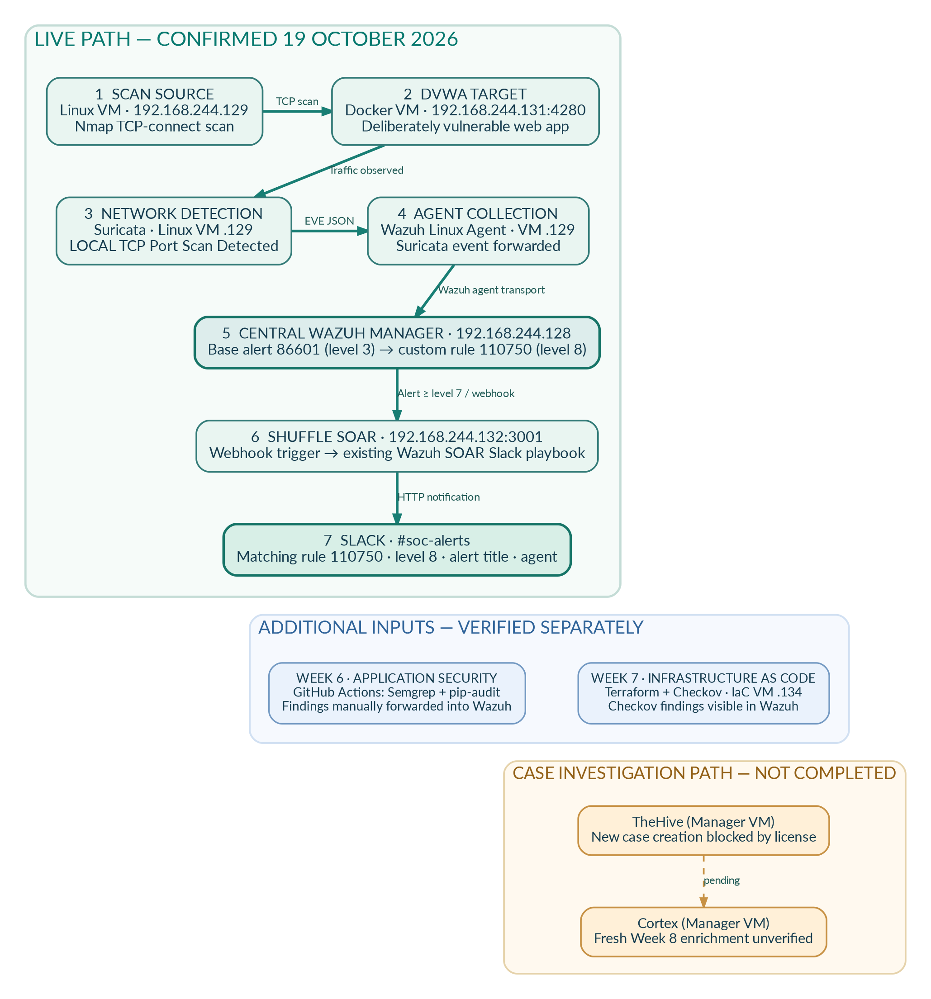

# SOC architecture and integration boundaries

The [final Task 48 architecture overview](../documentation/task-48-architecture-overview.docx) is included unchanged. A [Markdown companion](../documentation/task-48-architecture-overview.md) retains its narrative, tables and integration explanations. The diagram below is the actual PNG embedded in the supplied document, extracted without editing.

## Verified and separate flows

The verified live path is Nmap on Linux Agent `.129` → DVWA `.131:4280` → Suricata observation → Wazuh agent collection → Manager `.128` → targeted Rule 110750 Level 8 → Shuffle `.132:3001` → Slack. As the original document explains, diagram arrows represent event flow and observed traffic; they do not mean that every packet traverses every machine or prove visibility of all VM traffic.

The original overview records a Shuffle forwarding threshold of Level 7. The base Suricata event reached Wazuh under Rule 86601 at Level 3, below that condition. The custom rule assigns Level 8 to the specific source/destination/signature combination. This is a targeted Wazuh classification; it does not explain or establish a conversion to the additional `severity: 3` in the Shuffle payload.

Week 6 GitHub Actions scanning and agent-file ingestion are separate stages with a manual handoff. Week 8 live tests show Semgrep 100201 Level 10 and pip-audit 100203 Level 12. Checkov findings from IaC Lab `.134` appear under 110701 Level 12, while the supplied Checkov checkpoint includes a remote API DNS failure. No complete automatic CI-to-Wazuh path or successful full Checkov rescan is inferred.

## Source account and screenshot qualifications

The final overview states that TheHive/Cortex were deployed on the Manager VM during earlier weeks. Its original diagram retains that assignment. E02 lists those containers at a Docker Agent prompt; the source account and that screenshot do not independently reconcile physical Week 8 placement. The supplied diagram is preserved as authored, and this discrepancy is disclosed rather than silently changing it.

TheHive licensing prevented a fresh Week 8 case, and E36 shows a zero-server Cortex quota warning. The overview also reports a VirusTotal no-record result: that is neither a malicious/clean verdict nor completed Cortex enrichment. The case/enrichment branch remains incomplete.

The source overview says the Manager was configuration-tested and restarted. Exact commands are not visible in the selected screenshots, so they are described as source-reported steps. Configuration presence, status HTTP 200, synthetic logtest, live agent transport and final notification each have distinct proof boundaries.

## Final event trace

Manager E70, Shuffle E71 and Slack E58 share `2026-10-19T15:56:48.758+0000`, Rule 110750 and the recon description. The Shuffle screen still says EXECUTING, so final completion of every branch is not established. Slack receipt is independently visible. The original overview/runbook identify #soc-alerts; the supplied Slack crop omits the channel header.

The revised [four-section runbook](../documentation/incident-response-runbook.md) records that containment was unnecessary for this authorized test. Proposed responses to unauthorized activity are not actions performed during the supplied event.
