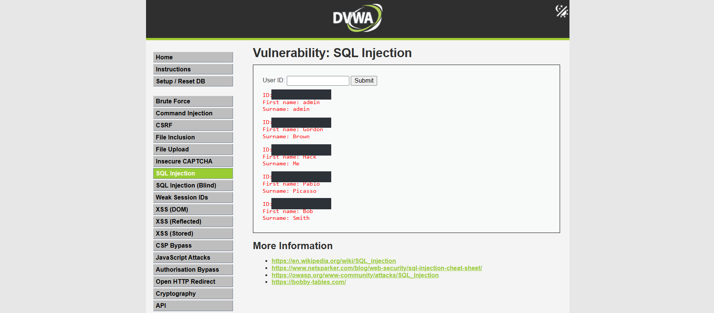
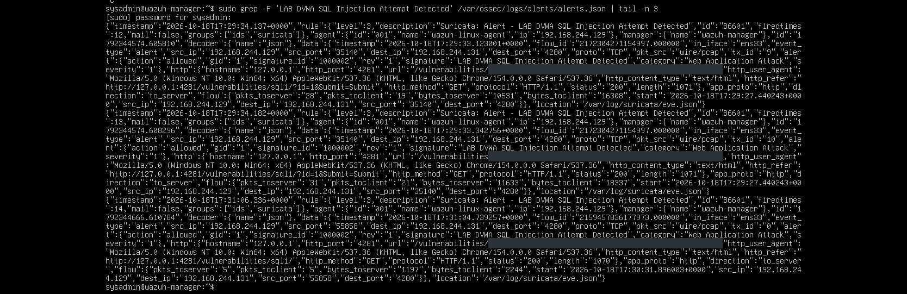
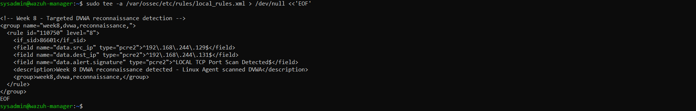
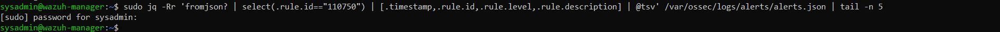
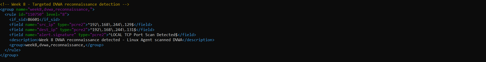
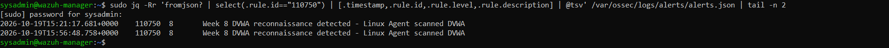
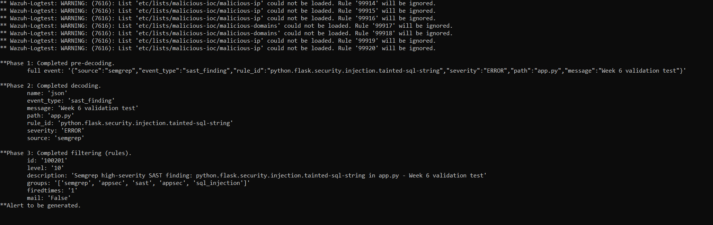
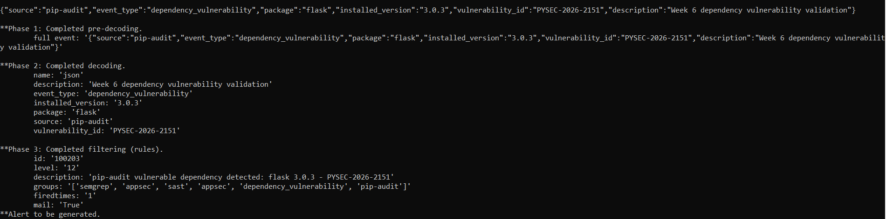
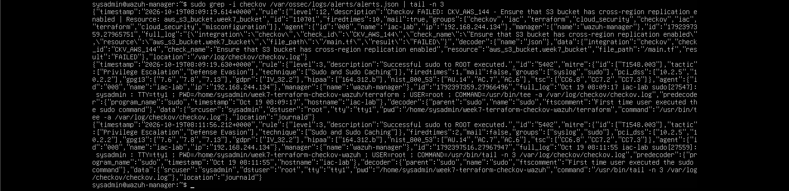

# Detection logic and proof boundaries

## SQL injection signature

E30 shows the complete local Suricata rule below. This is a transcription of the visible configuration, not a file exported from the VM. Line wrapping is removed; the matching expressions and lab addresses are preserved.

```text
alert http 192.168.244.129 any -> 192.168.244.131 4280 (msg:"LAB DVWA SQL Injection Attempt Detected"; flow:established,to_server; http.uri.raw; content:"/vulnerabilities/sqli/"; startswith; content:"%27+OR+"; nocase; classtype:web-application-attack; sid:1000002; rev:1;)
```


*E30: Complete LAB DVWA SQL Injection Attempt Detected signature SID 1000002, revision 1, matching raw URI content.*

The rule observes established HTTP requests from the Linux Agent to the application and matches the raw URI path plus an encoded quote/OR pattern. It is narrow to this exercise and is not a general SQL injection detector. `suricata -T` validates loading, not whether attack traffic matches. E31-E32 supply the retest and generated alerts; E33 proves manager ingestion under Rule 86601 Level 3. The action `allowed` is preserved; no inline prevention is established.


*E27: Suricata configuration test reports successful loading; configuration validity alone is not detection.*



*E31: SQL injection retest still returns multiple records after signature setup.*


*E32: Suricata eve.json contains repeated SQLi alerts from Linux Agent to DVWA.*



*E33: Wazuh alerts.json ingests the SQLi signature as Rule 86601, Level 3; action allowed indicates detection, not blocking.*

The earlier editor image E28 also shows part of the port-scan signature, but its line is clipped. A complete deployable port-scan rule is therefore not reconstructed. SID 1000001 and its `LOCAL TCP Port Scan Detected` output are observed; exact threshold parameters must not be invented.

## Reconnaissance correlation

The initial E62 child rule matched `data.src_ip`, `data.dest_ip` and `data.alert.signature`. E64 returned no custom rows. E65 showed base events, and E66 removed the `data.` prefixes. This is a schema-boundary issue: the manager alert JSON wraps decoded values in `data`, while custom-rule field matching uses their decoded names.



*E62: Initial custom Rule 110750 uses data-prefixed fields; later query produces no custom match.*



*E64: Query for custom Rule 110750 returns no rows at this checkpoint; base detection existed.*

The final child rule is [transcribed here](../configs/week8-recon-rule.xml). Its parent `if_sid` is 86601, destination/source are anchored to the tested lab pair, and the signature is anchored to the exact port-scan message. Level 8 is Wazuh rule metadata. Later 110750 matches establish the resulting behavior, though the screenshots do not show the exact save/reload command.



*E66: Corrected Rule 110750 uses src_ip, dest_ip and alert.signature; parent 86601, Level 8.*



*E70: Two custom Rule 110750 Level 8 alerts; final event 15:56:48.758+0000 matches Shuffle and Slack.*

## AppSec and IaC controls

The Week 8 synthetic and live Semgrep tests match 100201 Level 10. They do not validate the earlier Week 6 final rule 100202 Level 12; the supplied Week 8 record is retained as observed. pip-audit matches 100203 Level 12. A test payload's Flask version is not the installed version of the passing CI job. Checkov matches 110701 Level 12; broad grep output also includes unrelated successful sudo records.



*E47: Synthetic Semgrep logtest matches Rule 100201 Level 10 despite unrelated missing-list warnings.*



*E48: Synthetic pip-audit logtest matches Rule 100203 Level 12.*



*E43: Checkov finding reaches Wazuh Rule 110701 Level 12; generic sudo records in the broad query are unrelated.*

No fresh technical tests were run against the lab during documentation preparation. Configurations here describe observed historical behavior and have not been installed or revalidated on the VMs.
