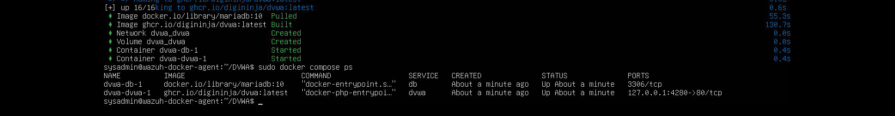
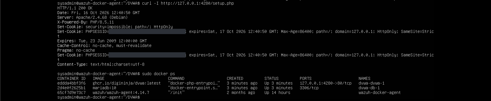
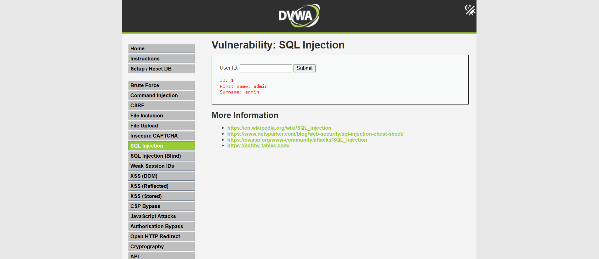
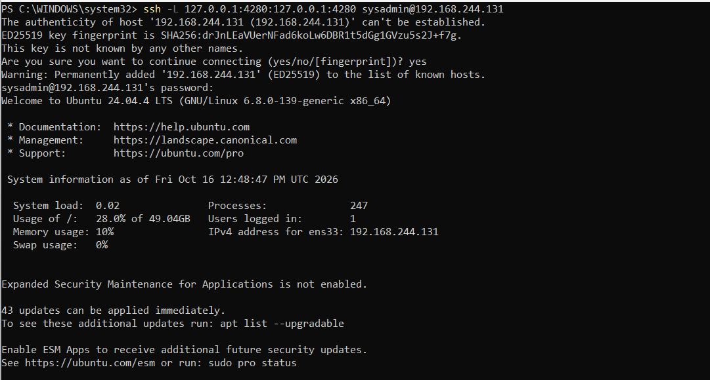
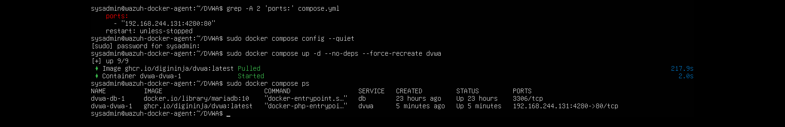
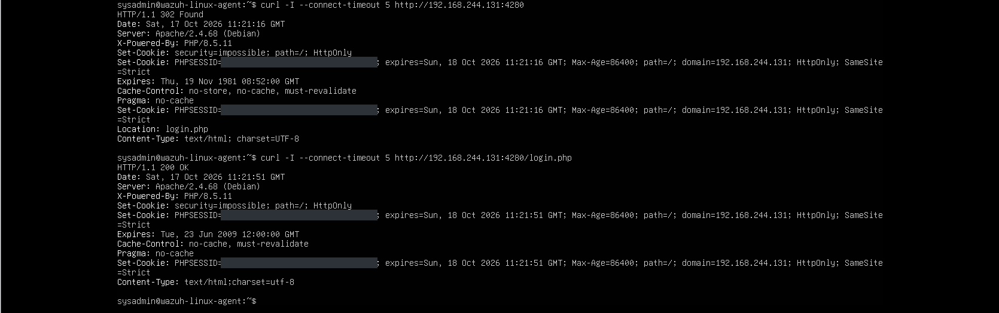
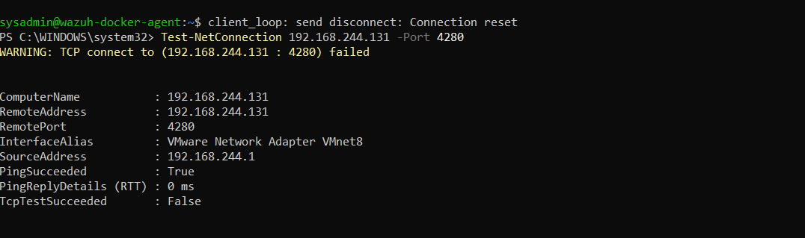

# DVWA deployment and database evidence

This record explains the historical Docker deployment visible in the supplied screenshots. It does not install or run DVWA during portfolio preparation.

## Source and service startup

E03 records cloning `https://github.com/digininja/DVWA.git` on the Docker Agent. E05 shows the DVWA and MariaDB services running with the application initially published as `127.0.0.1:4280->80/tcp`. E06 requests headers from `http://127.0.0.1:4280/setup.php` and receives HTTP 200. The cookie values are hidden in a separate copy; the status, headers and service listing remain unchanged.

*E03: DVWA source clone completed on the Docker Agent.*

*E05: DVWA and MariaDB running; initial host binding is loopback 127.0.0.1:4280.*

*E06: Local setup.php returns HTTP 200; session-cookie values redacted; application and agent containers remain visible.*

The recorded application image is `ghcr.io/digininja/dvwa:latest` and the database is MariaDB 10. These describe the lab checkpoint, not immutable image versions or a current deployment recommendation. A complete safe Compose export was not supplied, so no credential-bearing configuration is reconstructed.

## Database initialization boundary

Source image E08 shows DVWA's Database Setup page, setup checks and MySQL/MariaDB backend. It is inventoried but not selected for the public set because it repeats weaker setup evidence and displays default login text. The screenshot does not show the completion of a Create / Reset Database action, and no successful initialization command is visible. Therefore the exact initialization operation and its completion message are not invented.

The later authenticated SQL Injection page and returned DVWA training records in E23/E25/E31 establish that the application had a populated, functioning database for the exercise. This is operational evidence, distinct from a screenshot of the initialization procedure. Existing MariaDB service uptime is not by itself proof of database initialization.

*E23: Normal User ID 1 query returns a single DVWA record before SQL injection.*

## Port binding and access control

The loopback binding made local HTTP possible but did not expose the service at the VM's network address. E07 records SSH local forwarding to reach that loopback endpoint. E15 later shows the binding `192.168.244.131:4280:80`, `docker compose config --quiet`, and `docker compose up -d --no-deps --force-recreate dvwa`. These commands check the Compose document and recreate the selected application service without recreating dependencies.

*E07: SSH local forwarding to the loopback-bound application; host-key fingerprint is public key identification, not a private key.*

*E15: Compose configuration checked, DVWA recreated, and lab-IP port binding verified.*

The DOCKER-USER restriction in E13 drops traffic for the original DVWA destination/port when its source is not the Linux Agent `.129`. Its first insertion fails due to malformed argument spacing; the corrected insertion and rule listing are preserved. Persistence across reboots was not tested in the evidence.

*E13: iptables insertion first fails with Invalid rule number; corrected command and source-restricted rule are listed.*

## Verification and troubleshooting

E16 receives HTTP 302 from the root and HTTP 200 from login.php using the allowed Linux Agent. E17 shows the Windows host can ping the VM but cannot establish TCP/4280, consistent with the restriction. E21 records forwarding the Windows host's local port 4281 through the allowed Linux Agent, including a connection-reset retry. E18 establishes that Suricata could observe application HTTP requests on the tested path.

*E16: Allowed Linux Agent receives HTTP 302 and login.php HTTP 200; session-cookie values redacted.*

*E17: Windows host can ping but TCP/4280 fails; consistent with source restriction, not proof of application failure.*

*E18: Suricata HTTP events for DVWA port 4280 establish traffic visibility.*

These checkpoints validate different boundaries: a running container, a local HTTP response, a remote allowed-source response, and sensor traffic visibility. They should not be collapsed into a single generic deployment-success claim. Detailed failed approaches are retained in [troubleshooting](troubleshooting.md) and the [chronology](technical-chronology.md).
