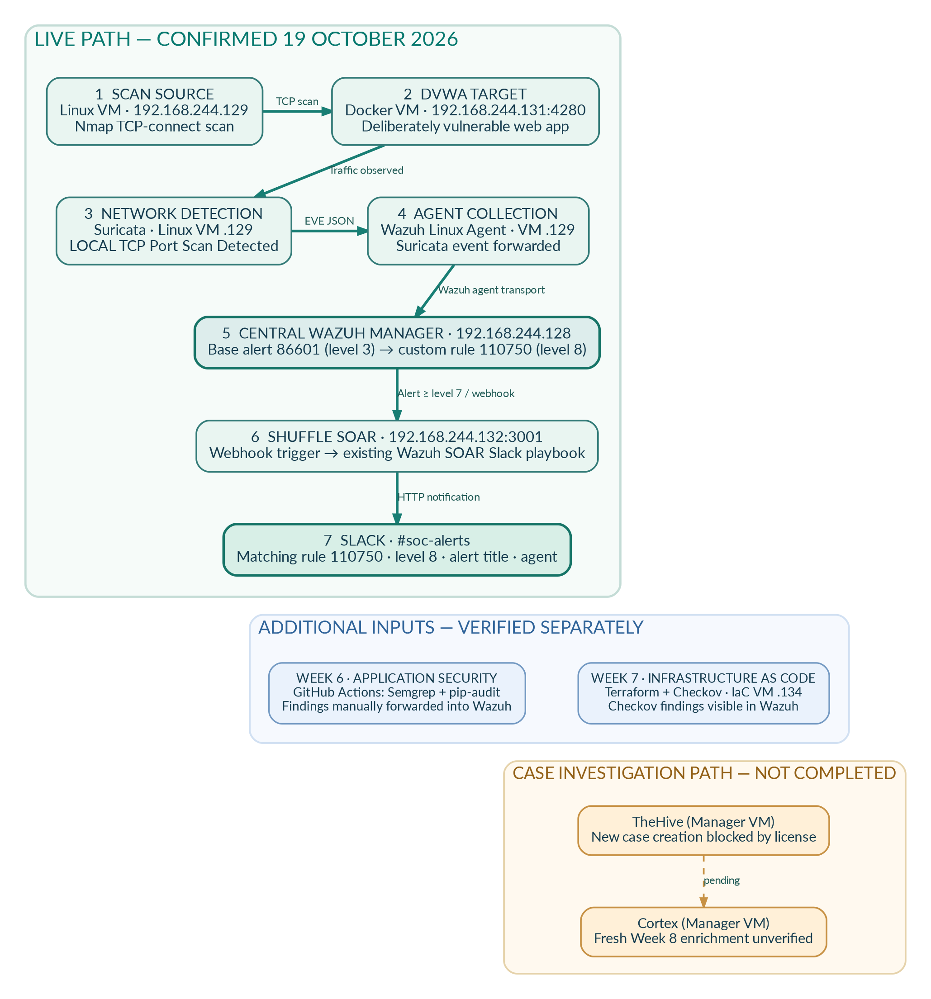

# Task 48 — SOC Architecture Overview

[Original supplied Word document](task-48-architecture-overview.docx). This Markdown companion transcribes the supplied final overview; its embedded diagram is extracted unchanged.

Week 8 | Final SOC Integration | October 2026

I used the final week of my lab to connect the tools I had worked with across the project and test whether one attack could produce an alert that reached the person monitoring the environment. The part I was most interested in was the movement of an event: from activity on a target machine, through a network sensor, into a central monitoring platform, and finally to a Slack notification. I also wanted to check that the application-security and infrastructure-security findings from Weeks 6 and 7 were still reaching the same Wazuh environment.

## How I arranged the lab

The environment runs on separate virtual machines. I kept each machine responsible for a particular part of the monitoring process rather than installing every tool on one host. The DVWA web application sits on the Docker VM, Suricata and a Wazuh agent handle network detection on the Linux VM, and the Wazuh Manager is the point where alerts are collected and evaluated. Shuffle handles the automation side, while Slack is where the alert becomes visible as a notification.

The diagram on the next page shows the path I actually verified in Week 8. I separated the Week 6/7 inputs from that live test so they would not be mistaken for steps in the same scan. TheHive and Cortex also appear separately because I could not complete new case creation and enrichment during the final test.

### Lab components and responsibilities

| System / service | Address / location | What I used it for |
| --- | --- | --- |
| Linux VM + Suricata + Wazuh Agent | 192.168.244.129 | Ran Nmap; detected the scan in Suricata; forwarded logs and test security findings. |
| Docker VM + DVWA + Docker Wazuh Agent | 192.168.244.131:4280 | Hosted DVWA as the target web application; retained the existing Docker agent. |
| Wazuh Manager and Dashboard | 192.168.244.128 | Received agent events; applied the custom reconnaissance rule; centralized findings. |
| Shuffle SOAR | 192.168.244.132:3001 | Received webhook events and ran the existing Wazuh-to-Slack playbook. |
| Slack | Channel: #soc-alerts | Displayed the security notification from the Week 8 scan. |
| IaC lab | 192.168.244.134 | Ran Terraform/Checkov checks and sent associated findings to Wazuh. |

### Evidence I used to check the links

Nmap output, Wazuh rules 86601 and 110750, the Shuffle webhook execution, the matching Slack #soc-alerts message, the Week 6 GitHub Actions result, Week 7 Checkov findings and the TheHive license error. I checked the rule ID and alert description between systems rather than relying only on a working dashboard.

## Architecture diagram and event flow

Figure 1. The recon-to-notification path I verified, with the supporting scan sources and the unfinished case-management path shown separately.

In the live path, the arrows represent events being passed along—not every packet being forwarded through every machine. The scan first creates traffic against DVWA; Suricata detects activity it can observe; the local Wazuh agent collects the resulting log; and the Manager evaluates the event before passing the qualifying alert to Shuffle.

## What happened during the reconnaissance test

### Step 1 — I scanned the DVWA machine

I used the Linux VM at 192.168.244.129 as the test machine. DVWA was running on the Docker VM at 192.168.244.131 and reachable through port 4280. To reproduce reconnaissance activity in a controlled way, I ran a TCP-connect Nmap scan against ports 1–1000 and 4280. The scan showed that the target responded and identified ports 22 and 4280 as open. Port 4280 confirmed that the DVWA service was reachable.

Command used:  nmap -sT -Pn -p 1-1000,4280 192.168.244.131

### Step 2 — Suricata detected the network activity

Suricata was already integrated with the Linux Wazuh Agent from my earlier work. It generated an event with the signature “LOCAL TCP Port Scan Detected.” The relevant event was visible in Wazuh as rule 86601, initially at level 3. I checked that the alert related to traffic from 192.168.244.129 toward the DVWA host at 192.168.244.131. This mattered because I needed to know the alert was connected to my test and not just an unrelated notification.

### Step 3 — I matched this event with a specific Wazuh rule

My Shuffle integration was configured to forward alerts at level 7 and above, so the original level-3 scan alert would not meet that threshold. Rather than increasing the severity of every Suricata scan event, I added a custom rule in Wazuh for this particular test. Rule 110750 matches the parent Suricata rule 86601 together with the source IP, destination IP and scan signature, and gives the matching event level 8.

The description I used was “Week 8 DVWA reconnaissance detected - Linux Agent scanned DVWA.” I tested the rule configuration and restarted the Wazuh Manager before running the scan again. A new rule 110750 alert appeared in the Manager’s alerts log. This was the point where I knew the network event was being classified the way I intended.

### Step 4 — Wazuh delivered the alert to Shuffle

The Wazuh Manager already had the Week 5 Shuffle integration configured. That integration sends qualifying JSON alerts to a webhook on the Shuffle VM at 192.168.244.132:3001. I confirmed that the “Wazuh Alert Webhook” trigger was running, repeated the scan while Shuffle was online, and checked the workflow execution details. The new execution had webhook as its source and contained rule_id 110750, the same alert title, and the matching Wazuh timestamp.

### Step 5 — I checked the matching notification in Slack

The existing Shuffle playbook sent a message to #soc-alerts through the Wazuh SOAR Alerts application. The Slack message displayed rule ID 110750, Wazuh level 8, the same reconnaissance alert description, the Linux agent name and its IP address (192.168.244.129). This was the final confirmation: the event I generated on the target side appeared at the notification side without me manually posting the alert in Slack.

### How I matched the alert across the tools

| Stage | Identifier / result I checked |
| --- | --- |
| Suricata / initial Wazuh event | LOCAL TCP Port Scan Detected; base rule 86601 (level 3). |
| Custom Wazuh alert | Rule 110750 (level 8); “Week 8 DVWA reconnaissance detected - Linux Agent scanned DVWA”. |
| Shuffle execution | Webhook source; rule_id 110750; matching event title and timestamp. |
| Slack #soc-alerts | Wazuh SOAR Alerts notification; rule 110750, level 8, agent wazuh-linux-agent. |

## How the previous weeks fit into the same architecture

Week 6 — application-security findings

For the application-security part of the lab, I used GitHub Actions to run Semgrep and pip-audit. In the Week 8 verification run, Semgrep checked 11 targets with 341 rules and reported nine blocking findings, which caused its job to fail as a security gate should. The pip-audit job passed in that run. I also confirmed Semgrep and pip-audit alert types in Wazuh under rules 100201 and 100203. At this stage, forwarding the GitHub findings into the Linux agent logs still involved a manual step, so I have not described that part as a fully automated GitHub-to-Wazuh pipeline.

Week 7 — Terraform and Checkov findings

For infrastructure-as-code security, the IaC lab at 192.168.244.134 used Checkov to scan Terraform configurations. I confirmed its results in the same Wazuh deployment used for network and application events. In the Week 8 check, rule 110701 appeared for Checkov findings at level 12. This means the Manager can display different classes of security problems together, even though the scan against DVWA and the Checkov checks were separate activities.

TheHive, Cortex and enrichment

TheHive and Cortex were deployed as containers on the Wazuh Manager VM during earlier weeks. My intended architecture included creating an investigation case in TheHive and performing enrichment with Cortex. In Week 8, however, TheHive rejected its license, which prevented me from creating the fresh case needed to prove that part of the sequence. I left these components in the diagram as an incomplete branch rather than showing them as successful steps in the final alert path.

I also saw a VirusTotal lookup result reporting that no existing record was found for the SHA-256 value provided. I treated that as an unavailable enrichment result—not evidence that a file was malicious or clean, and not evidence of successful Cortex enrichment.

## What the final architecture test established

The strongest result from this integration test was being able to follow one identifiable reconnaissance event all the way from my Nmap command to Slack. I could see where the sensor detected the activity, where Wazuh applied the custom severity rule, and where Shuffle accepted the corresponding webhook payload. It also reminded me that having a workflow saved is not enough: the relevant services need to be online when the event happens, and the detection severity has to meet the forwarding condition.

I tested other attack steps during the broader Week 8 work, including SQL injection and an attempted privilege-escalation activity, but I did not verify the same complete alert-to-Slack path for those steps. My confirmed end-to-end outcome for this document is specifically the DVWA reconnaissance detection and Slack notification. Case creation and fresh Cortex enrichment remain unfinished because of the TheHive licensing issue.
