# Technical chronology and command explanation

This narrative uses original capture dates and observed event timestamps. Upload order was not chronological: the first item of several batches was a later screenshot. The [manifest](../evidence/evidence-manifest.csv) preserves both batch and upload sequence. Screenshot clocks, dashboard clocks and embedded log times differ; event timestamps are quoted as shown rather than converted using an assumed workstation timezone.

## October 15 — readiness

E02 inspects Docker/Compose, running containers, memory and disk. These are environment observations, not proof that every listed integration works. TheHive/Cortex container placement conflicts with the handoff's Manager assignment and remains unresolved.

## October 16 — local deployment and sensor readiness

E03 shows the DVWA clone. E05 shows Compose startup and `127.0.0.1:4280->80/tcp`; E06 uses `curl -I http://127.0.0.1:4280/setup.php` to request headers and obtains HTTP 200. The session-cookie values are hidden only in publication copies.

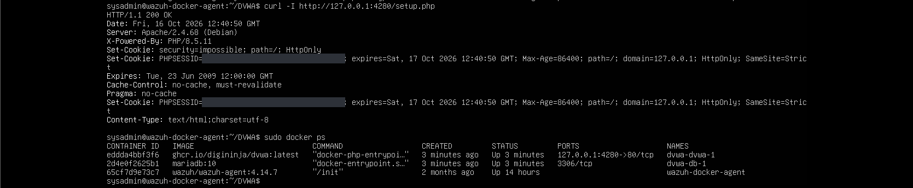

*E06: Local setup.php returns HTTP 200; session-cookie values redacted; application and agent containers remain visible.*

E07 uses `ssh -L 127.0.0.1:4280:127.0.0.1:4280 sysadmin@192.168.244.131` to forward the host's local port through SSH to the remote loopback service. This permits browser access without proving direct VM-network exposure. E08/E09 show setup and login screens; they are inventoried but not selected because later response evidence is stronger.

E10 runs `systemctl is-active suricata`, `ip -br addr` and checks `eve.json`. E11 inspects AF_PACKET's `ens33` entry and the running Suricata process. These checks establish service/configuration context; E18/E32 later establish traffic/detection output. E12 inspects Docker networks, UFW and forwarding chains; an inactive UFW does not mean Docker forwarding has no policy.

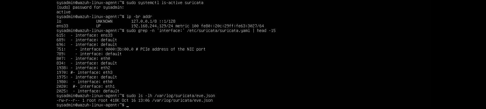

*E10: Suricata active; ens33 and eve.json checked.*

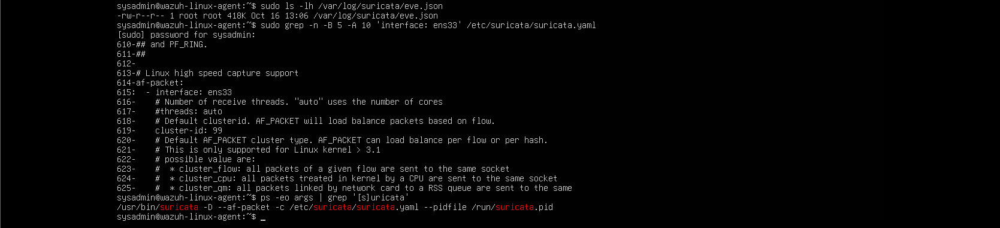

*E11: AF_PACKET capture configured on ens33 and active Suricata process shown.*

## October 17 — binding, access restriction and SQL injection

E13 first submits an iptables insertion with `1-i` instead of separate `1 -i` arguments, gets `Invalid rule number`, then lists the corrected DOCKER-USER rule. The `conntrack --ctorigdst/--ctorigdstport` matches the original pre-DNAT destination and port, while `! -s 192.168.244.129` selects other sources for DROP. No persistence across reboots is demonstrated.

E14 edits the Compose host binding but exposes database credentials and is excluded from the public set. E15 safely shows the selected port mapping and uses `docker compose config --quiet` to check configuration, then `docker compose up -d --no-deps --force-recreate dvwa` to recreate that service without its dependencies. The subsequent service listing confirms the lab-IP publication.

E16 requests headers from the allowed Linux Agent: root returns HTTP 302 and login.php returns HTTP 200. E17 shows a Windows host connection reset and `Test-NetConnection ... -Port 4280`: ICMP succeeds while TCP fails. These are distinct reachability checks, consistent with the restriction. E18 filters Suricata output for destination port 4280 and shows application HTTP events. E19 mixes other TLS telemetry and repeated cookie-bearing headers and is not selected.

*E18: Suricata HTTP events for DVWA port 4280 establish traffic visibility.*

E21 retries `ssh -N -L 127.0.0.1:4281:192.168.244.131:4280 sysadmin@192.168.244.129` after a reset. `-N` requests no remote command; the forwarding target is reached from the allowed Linux Agent. E22 sets DVWA Low. E23 queries ID 1; E25 uses a tautology and returns five records. E24/E26 inspect HTTP events and alert/rule-file configuration before the SQLi signature is finalized. `suricata -T -c /etc/suricata/suricata.yaml` succeeds in E27. E28's rule-editor line is partially clipped and is not treated as complete source.

## October 18 — SQLi signature and delivery limitations

E29 repeats the configuration test. E30 uses `grep -n 'sid:1000002' /var/lib/suricata/rules/local.rules` to display the complete SQLi signature. E31 repeats the multi-record SQLi response. E32 queries `eve.json` for alert events with that SID; E33 finds `LAB DVWA SQL Injection Attempt Detected` in the manager's alerts.json as Rule 86601 Level 3. The logged requests target port 4280. The public copies mask the replayable input values while preserving the alert results. These observations establish application exploitation and detection through the manager, not downstream SQLi case creation or blocking.

*E32: Suricata eve.json contains repeated SQLi alerts from Linux Agent to DVWA.*

E34 checks integrations in `ossec.conf` and files in `/var/ossec/integrations`. E35 shows `No route to host`, repeated webhook connection errors and exit 1. E36 displays the configured custom-thehive integration and TheHive status logs with a zero-server Cortex quota. Existing scripts and status 200 are intermediate checks, not proof of a fresh case.

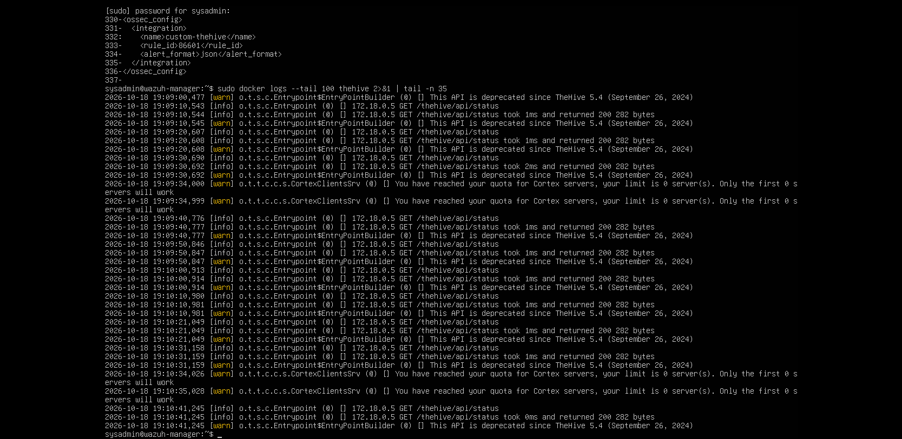

*E36: TheHive API status responses coexist with a zero-server Cortex quota warning; new Week 8 case/enrichment success is unverified.*

## October 19 — integration repair and regression checks

### Shuffle reachability and processing

E37 requests Shuffle frontend headers at .132:3001 and receives HTTP 200; `nc -vz` also succeeds from the Shuffle VM. The test origin matters: this does not establish manager-to-webhook reachability. E38 cannot find the extensionless `shuffle` launcher while `shuffle.py` is present. E40 later lists both, but manager transport errors still include refusal/timeout. The exact repair command and a single definitive cause of all transport failures are not captured.

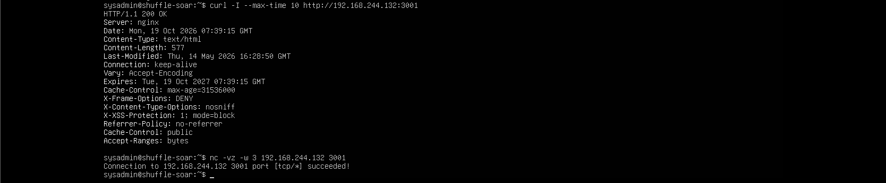

*E37: Shuffle frontend HTTP 200 and local port connectivity succeed; webhook delivery remains a separate test.*

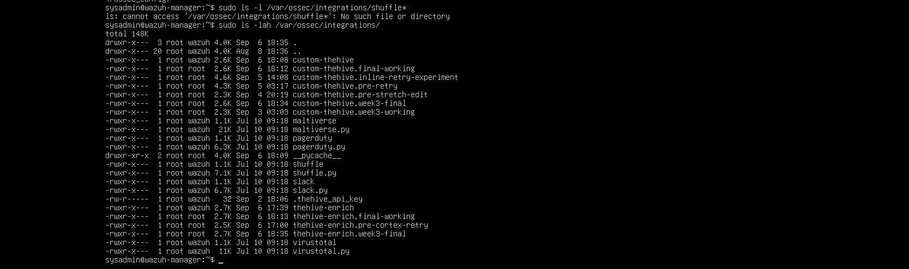

*E38: Extensionless shuffle launcher initially missing while shuffle.py exists.*

E41 shows backend webhook processing and some finished executions. It is useful recovery evidence but does not prove the final recon run reached a terminal state. Hook tokens and repeated hook IDs are masked in its publication copy.

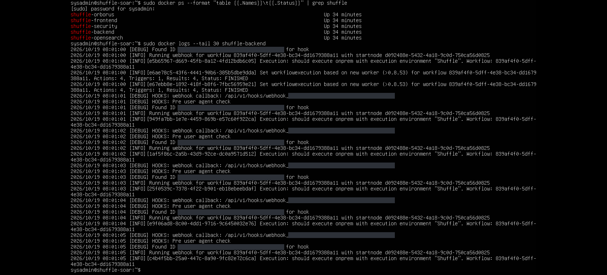

*E41: Shuffle backend records webhook processing and finished executions; hook identifier and callback tokens redacted; unrelated execution status is not final recon-run completion proof.*

### Checkov and AppSec ingestion

E42 contains a Checkov API DNS traceback and normalized failed records. E43's broad `grep -i checkov` output includes a real 110701 Level 12 finding and unrelated sudo activity. E44 searches the manager's collectors; E45 checks the actual AppSec collector paths on the Linux Agent. The initial `find` searched filenames, so searching for “semgrep” did not necessarily find a file named `findings.json` under a semgrep directory. E46 checks exact paths and their existing content.

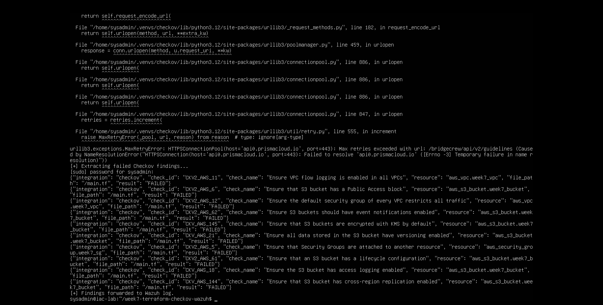

*E42: Checkov API name resolution fails, while normalized failed-check records are printed below; completeness of that scan is not established.*

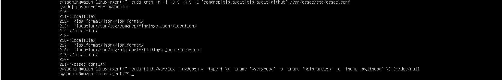

*E45: Linux Agent collects JSON from /var/log/semgrep/findings.json and /var/log/pip-audit/findings.json.*

E47/E48 run synthetic decoding/matching tests. E49 appends marked Semgrep JSON with `printf ... | sudo tee -a /var/log/semgrep/findings.json`; E50 independently reads the resulting manager alert. Appending exercises the agent's monitored file and transport, while logtest alone exercises the manager's matching logic. E51/E52 do the same for the pip-audit test record. These are controlled payloads, not proof of fresh scanner export from the current CI run.

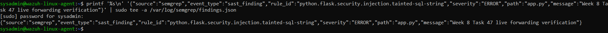

*E49: Controlled Semgrep test JSON appended to the monitored agent file; not a fresh scanner export.*

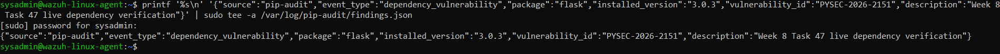

*E51: Controlled pip-audit dependency test JSON appended; vulnerable version is a test payload, not the current CI dependency state.*

### Privilege test and Actions checkpoint

E53 explicitly enters the container as `www-data`, prints identity before and after an attempted `timeout 5 su root -c id </dev/null`, and records authentication failure/exit 1. No elevated identity appears. E54/E55 show the combined AppSec/IaC dashboard, with the fuller E54 selected. E56 is a README editor narrative and E57 an Actions run listing; E39 and E59 provide stronger actual run evidence: Semgrep nine blocking findings/exit 1, pip-audit green, two artifacts shown in the summary.

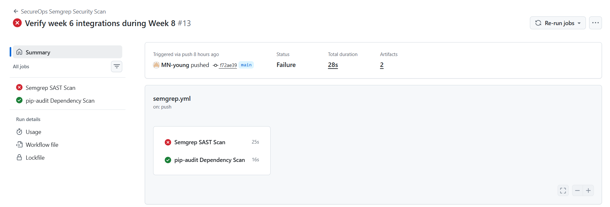

*E39: GitHub Actions run summary: Semgrep fails, pip-audit passes, two artifacts; no direct CI-to-Wazuh delivery proven.*

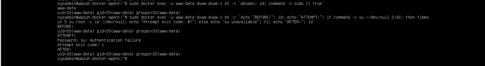

*E53: Operator uses docker exec -u www-data; su authentication fails with exit 1 and before/after uid remains 33.*

## October 19 — custom recon rule correction and final trace

### Interpreting the manager search

E60's broad `grep -aiE 'dvwa|sql.injection' ... | ... | cut -c 1-300` includes a Semgrep event and generic root sudo alerts. Truncation and broad matching prevent attributing those records to the failed container escalation.

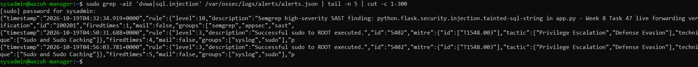

*E60: Broad grep returns Semgrep and generic Successful sudo to ROOT alerts; these do not establish www-data escalation or detection of its failed su attempt.*

### Rule correction

E61 establishes the base port-scan alert for the .129 → .131 pair. E62 appends a child rule with data-prefixed fields. E63 scans ports 1–1000 and 4280; E64 finds no 110750 rows; E65 still has base detections. E66 shows the corrected field names. The final Task 48 overview reports testing the configuration and restarting the Manager. The precise commands are not visible in the screenshots, so no exact reload command is reconstructed.

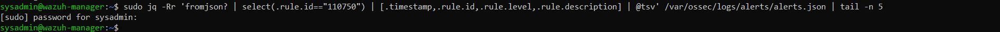

*E64: Query for custom Rule 110750 returns no rows at this checkpoint; base detection existed.*

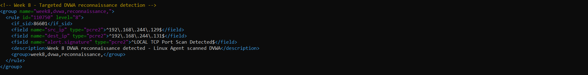

*E66: Corrected Rule 110750 uses src_ip, dest_ip and alert.signature; parent 86601, Level 8.*

### Correlating the final delivery

E67's scan is followed by E68's first 110750 Level 8 alert at 15:21:17.681+0000. E69 repeats the scan at 15:56 UTC. E70 lists both matches, including 15:56:48.758+0000. E71 and E58 carry that same event timestamp and rule into Shuffle and Slack respectively. The former still reads EXECUTING; the latter independently confirms notification delivery. The handoff names #soc-alerts, while the Slack crop omits the header. No TheHive case or completed Cortex analyzer is shown.

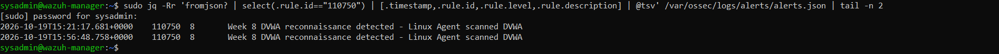

*E70: Two custom Rule 110750 Level 8 alerts; final event 15:56:48.758+0000 matches Shuffle and Slack.*

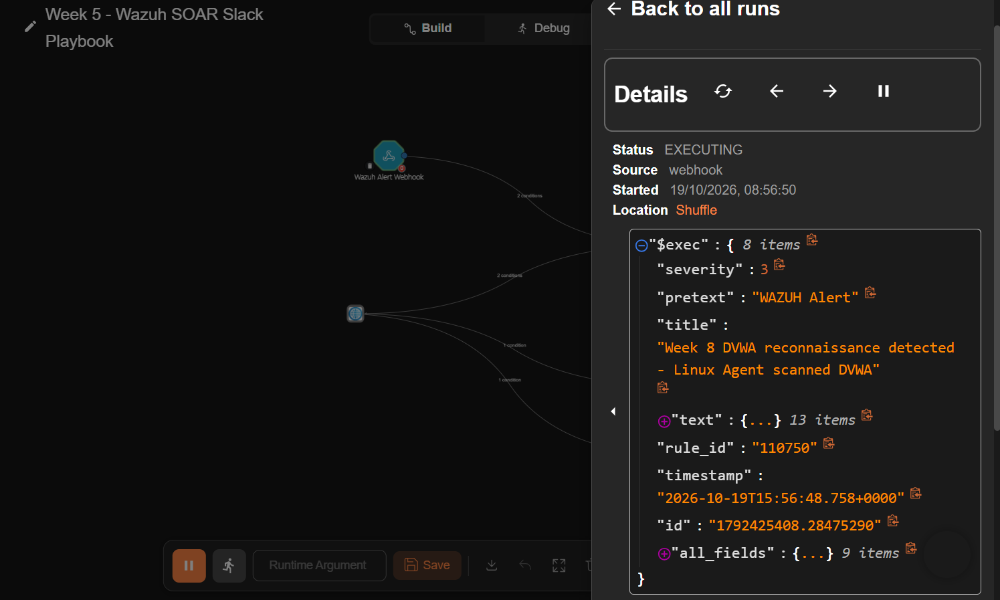

*E71: Final reconnaissance payload in Shuffle, Rule 110750 and matching timestamp; UI status EXECUTING; extra severity 3 origin unresolved.*

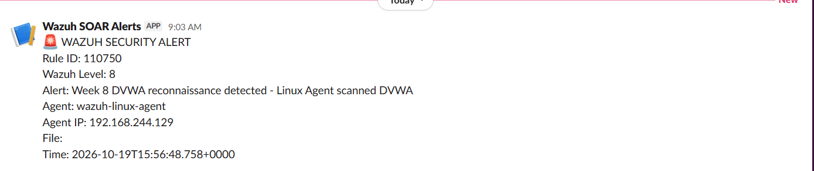

*E58: Slack notification matches Rule 110750 Level 8 and final manager event timestamp; destination channel reported by handoff, channel label not visible in crop.*