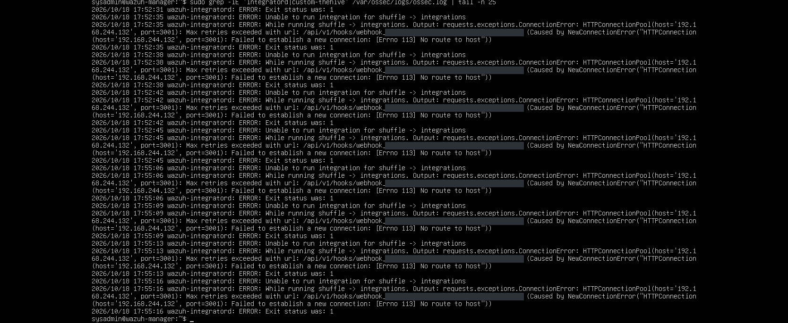
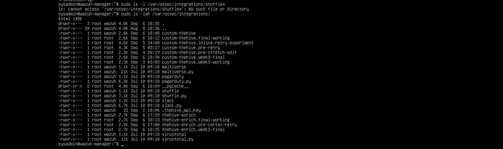
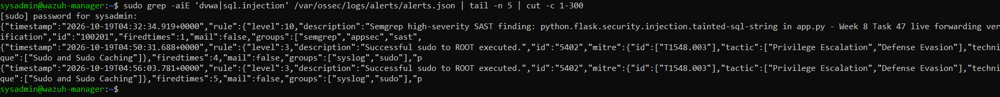
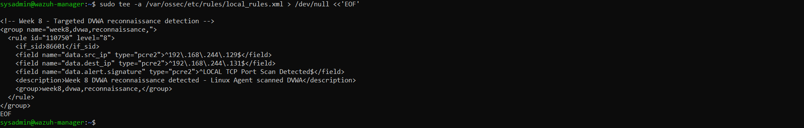
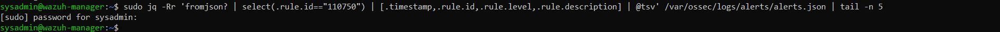

# Troubleshooting register

The failures below are part of the lab's technical record. A correction is described as verified only to the extent supported by its checkpoint. Historical commands are explained, not executed against the current VMs.

| Stage | Symptom and investigation | Correction or later state | Boundary |
| --- | --- | --- | --- |
| Initial publication | Local curl works but Compose binds 127.0.0.1:4280 (E05–E07) | SSH forwarding permits local access; E15 later binds .131:4280 | Local HTTP success alone cannot prove remote reachability |
| Docker networking | UFW inactive, FORWARD DROP and Docker chains examined (E12) | E13 adds source restriction; E15/E16 show allowed access | No generalized firewall diagnosis or persistence proof |
| Rule insertion typo | `1-i` produces Invalid rule number (E13) | Separate `1 -i` command succeeds; listed DOCKER-USER rule retained | Exact visible command repair |
| Direct Windows test | Ping works, TCP/4280 fails, SSH reset occurs (E17/E21) | Tunnel via allowed Linux Agent retried | Restriction is consistent with failure; do not call the app down |
| Sensor coverage | Active service/config alone inconclusive (E10/E11) | HTTP 4280 records and later SQLi alerts observed (E18/E32) | No proof of all-segment monitoring |
| SQLi coverage | Early HTTP evidence does not establish SQLi signature matching (E24/E26) | Config validates, complete SID 1000002 shown, retest and alert ingestion (E27/E30–E33) | Specific raw-URI signature; no generic prevention claim |
| Case/enrichment | Existing integration and API HTTP 200 coexist with zero Cortex quota (E34/E36) | No supplied fix or fresh successful case | Licensing limitation reported; host placement unresolved |
| Shuffle network | No route to host, exit 1; later refusal/timeout (E35/E20/E40) | Backend processing and final matching payload/Slack later observed | Exact cause of each failure and all repair commands unrecorded |
| Shuffle launcher | Extensionless launcher missing, shuffle.py exists (E38) | Later both files present (E40) | Existence alone did not resolve transport failures |
| Health versus delivery | Frontend curl/nc succeed from Shuffle VM (E37) | Final manager timestamp traced through E70/E71/E58 | Test origin and API path differ |
| Checkov API | api.prismacloud.io temporary name-resolution failure (E42) | Normalized failures printed; Wazuh manager/dashboard visibility (E43/E54) | Complete successful fresh scan not established |
| Finding discovery | Filename search returns no matches despite configured directory paths (E45) | Exact path listing and tail find normalized files (E46) | Do not infer missing logs from basename-only search |
| Logtest warnings | Missing malicious-IOC lists, unrelated 7616 warnings (E47) | AppSec test still reaches intended matching phase | Other rules may be ignored; warning not globally resolved |
| Synthetic versus live | Logtest succeeds (E47/E48) | Agent appends independently appear at manager (E49–E52) | Neither stage proves automatic CI artifact ingestion |
| Semgrep control gate | Actions run is red (E39/E59) | Scan found 9 blocking findings, exit 1; pip-audit job passed | Expected security gate behavior, not scanner startup failure |
| www-data escalation | su authentication fails; UID remains 33 (E53) | No successful escalation | Generic admin sudo alerts are unrelated (E60) |
| Recon custom matching | Base 86601 present but no 110750 result (E61–E65) | E66 removes data. wrapper; E70 shows two custom matches | Task 48 reports a Manager restart; precise commands not visible |
| Severity interpretation | Shuffle shows severity 3, manager/Slack show Level 8 (E71/E70/E58) | Values recorded independently | Mapping/origin unresolved |
| Clock differences | Filename/display/log times differ | Correlate identical embedded final event timestamp | No unsupported timezone normalization |

## Retained failed and intermediate evidence

_E13: iptables insertion first fails with Invalid rule number; corrected command and source-restricted rule are listed._

_E17: Windows host can ping but TCP/4280 fails; consistent with source restriction, not proof of application failure._

_E35: Wazuh-to-Shuffle fails with No route to host and exit status 1; webhook token redacted._

_E38: Extensionless shuffle launcher initially missing while shuffle.py exists._

_E42: Checkov API name resolution fails, while normalized failed-check records are printed below; completeness of that scan is not established._

_E60: Broad grep returns Semgrep and generic Successful sudo to ROOT alerts; these do not establish www-data escalation or detection of its failed su attempt._

_E62: Initial custom Rule 110750 uses data-prefixed fields; later query produces no custom match._

_E64: Query for custom Rule 110750 returns no rows at this checkpoint; base detection existed._

## What remains to investigate

A future lab session could establish exact case-stack placement, resolve licensing/Cortex quota, validate new case creation and analyzer output, capture the complete port-scan rule, explain the additional Shuffle severity field and trace the Week 6 rule-ID difference. It could also test persistent firewall behavior and automatic CI artifact delivery. None of those future activities has been claimed complete in this portfolio.
