# Selected Week 8 screenshot gallery

These are the actual 45 selected image copies. The four copies with credential redactions appear first. The SQL injection images E25, E31 and E33 mask replayable test inputs. Open each linked PNG to inspect it at full resolution. Original evidence is preserved privately. See the [catalog](README.md) and [manifest](evidence-manifest.csv) for the complete selection and all 71 source decisions.

## E06 — Screenshot 2026-10-16 134442.png

Local setup.php returns HTTP 200; session-cookie values redacted; application and agent containers remain visible.

Redaction: Opaque blocks over PHP session-cookie values.

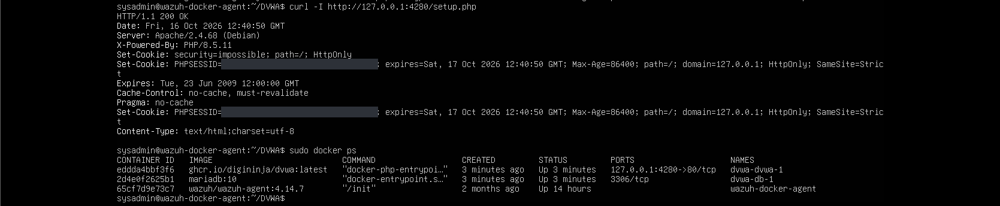

[Open full-resolution copy](dvwa/E06-2026-10-16-134442.png)

## E16 — Screenshot 2026-10-17 122451.png

Allowed Linux Agent receives HTTP 302 and login.php HTTP 200; session-cookie values redacted.

Redaction: Opaque blocks over PHP session-cookie values.

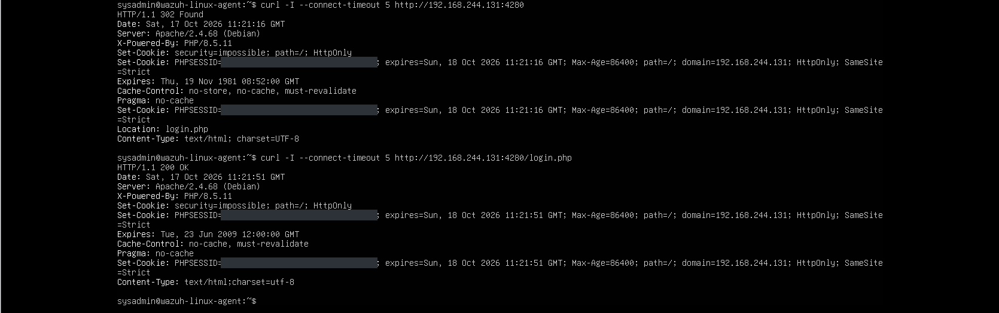

[Open full-resolution copy](dvwa/E16-2026-10-17-122451.png)

## E35 — Screenshot 2026-10-18 110149.png

Wazuh-to-Shuffle fails with No route to host and exit status 1; webhook token redacted.

Redaction: Opaque blocks over webhook token in every repeated URL.

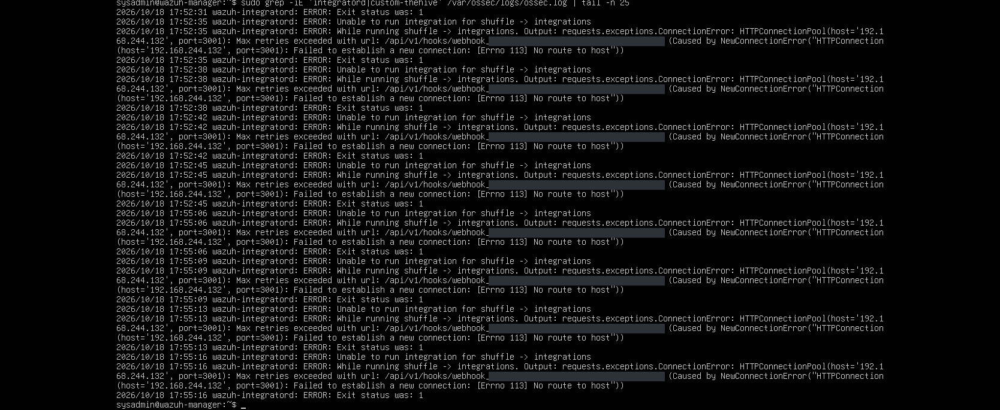

[Open full-resolution copy](troubleshooting/E35-2026-10-18-110149.png)

## E41 — Screenshot 2026-10-19 010118.png

Shuffle backend records webhook processing and finished executions; hook identifier and callback tokens redacted; unrelated execution status is not final recon-run completion proof.

Redaction: Opaque blocks over webhook token, including repeated hook IDs.

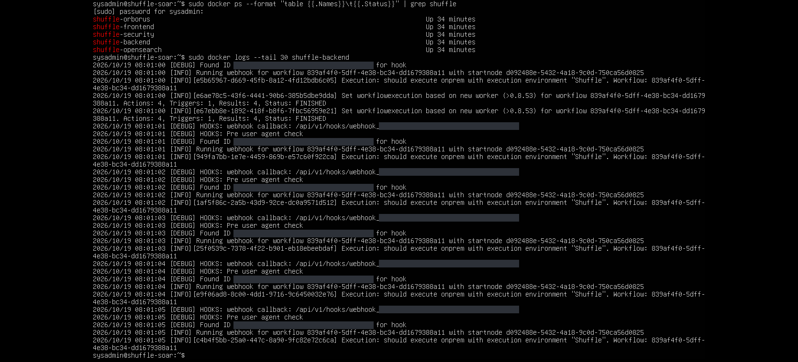

[Open full-resolution copy](shuffle/E41-2026-10-19-010118.png)

## E03 — Screenshot 2026-10-16 131741.png

DVWA source clone completed on the Docker Agent.

Redaction: No sensitive values identified in selected frame.

[Open full-resolution copy](dvwa/E03-2026-10-16-131741.png)

## E05 — Screenshot 2026-10-16 134159.png

DVWA and MariaDB running; initial host binding is loopback 127.0.0.1:4280.

Redaction: No sensitive values identified in selected frame.

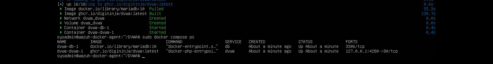

[Open full-resolution copy](dvwa/E05-2026-10-16-134159.png)

## E07 — Screenshot 2026-10-16 135351.png

SSH local forwarding to the loopback-bound application; host-key fingerprint is public key identification, not a private key.

Redaction: No sensitive values identified in selected frame.

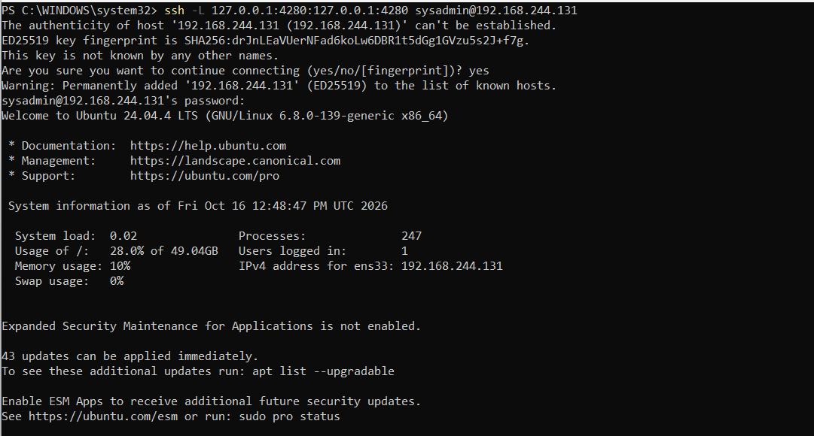

[Open full-resolution copy](dvwa/E07-2026-10-16-135351.png)

## E10 — Screenshot 2026-10-16 142516.png

Suricata active; ens33 and eve.json checked.

Redaction: No sensitive values identified in selected frame.

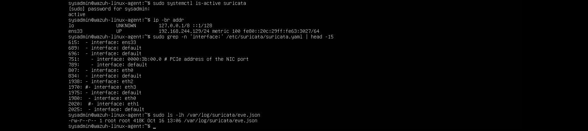

[Open full-resolution copy](dvwa/E10-2026-10-16-142516.png)

## E11 — Screenshot 2026-10-16 142655.png

AF_PACKET capture configured on ens33 and active Suricata process shown.

Redaction: No sensitive values identified in selected frame.

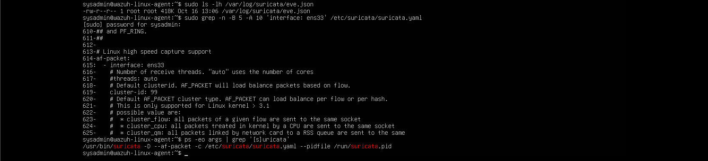

[Open full-resolution copy](dvwa/E11-2026-10-16-142655.png)

## E13 — Screenshot 2026-10-17 111513.png

iptables insertion first fails with Invalid rule number; corrected command and source-restricted rule are listed.

Redaction: No sensitive values identified in selected frame.

[Open full-resolution copy](troubleshooting/E13-2026-10-17-111513.png)

## E15 — Screenshot 2026-10-17 122312.png

Compose configuration checked, DVWA recreated, and lab-IP port binding verified.

Redaction: No sensitive values identified in selected frame.

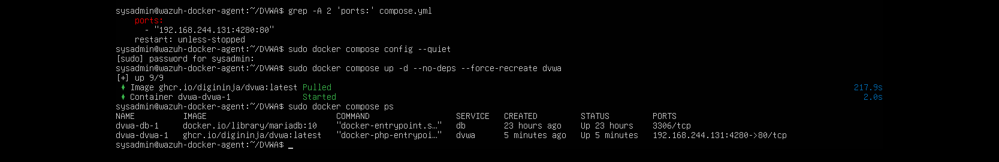

[Open full-resolution copy](dvwa/E15-2026-10-17-122312.png)

## E17 — Screenshot 2026-10-17 122728.png

Windows host can ping but TCP/4280 fails; consistent with source restriction, not proof of application failure.

Redaction: No sensitive values identified in selected frame.

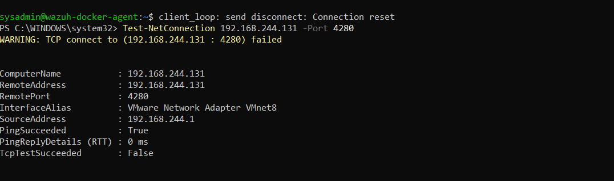

[Open full-resolution copy](troubleshooting/E17-2026-10-17-122728.png)

## E18 — Screenshot 2026-10-17 124344.png

Suricata HTTP events for DVWA port 4280 establish traffic visibility.

Redaction: No sensitive values identified in selected frame.

[Open full-resolution copy](dvwa/E18-2026-10-17-124344.png)

## E23 — Screenshot 2026-10-17 134028.png

Normal User ID 1 query returns a single DVWA record before SQL injection.

Redaction: No sensitive values identified in selected frame.

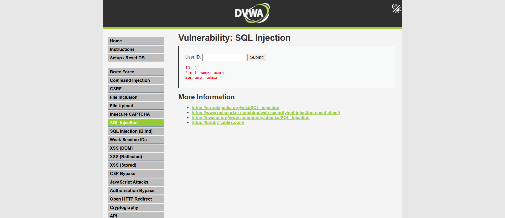

[Open full-resolution copy](sqli/E23-2026-10-17-134028.png)

## E25 — Screenshot 2026-10-17 140525.png

Tautology SQL injection returns five DVWA training records; exploitation of the lab query is demonstrated.

Redaction: Opaque masks over the replayable SQL input; all five returned records remain visible.

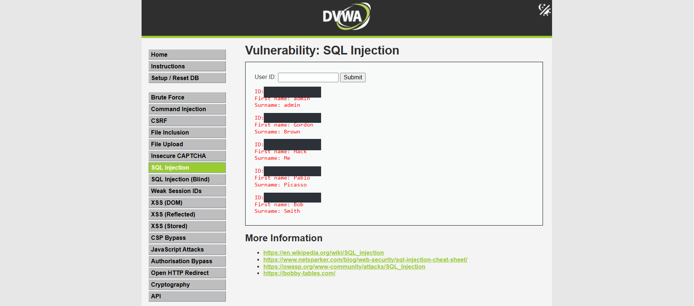

[Open full-resolution copy](sqli/E25-2026-10-17-140525.png)

## E27 — Screenshot 2026-10-17 151859.png

Suricata configuration test reports successful loading; configuration validity alone is not detection.

Redaction: No sensitive values identified in selected frame.

[Open full-resolution copy](sqli/E27-2026-10-17-151859.png)

## E30 — Screenshot 2026-10-18 101738.png

Complete LAB DVWA SQL Injection Attempt Detected signature SID 1000002, revision 1, matching raw URI content.

Redaction: No sensitive values identified in selected frame.

[Open full-resolution copy](sqli/E30-2026-10-18-101738.png)

## E31 — Screenshot 2026-10-18 103132.png

SQL injection retest still returns multiple records after signature setup.

Redaction: Opaque masks over the replayable SQL input; all five returned records remain visible.

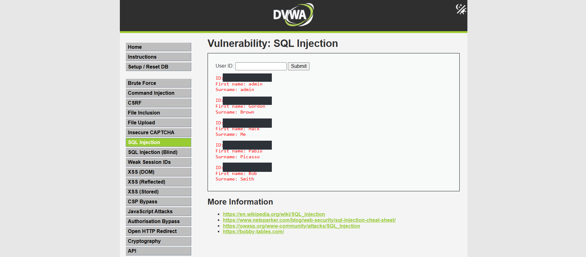

[Open full-resolution copy](sqli/E31-2026-10-18-103132.png)

## E32 — Screenshot 2026-10-18 103357.png

Suricata eve.json contains repeated SQLi alerts from Linux Agent to DVWA.

Redaction: No sensitive values identified in selected frame.

[Open full-resolution copy](sqli/E32-2026-10-18-103357.png)

## E33 — Screenshot 2026-10-18 103902.png

Wazuh alerts.json ingests the SQLi signature as Rule 86601, Level 3; action allowed indicates detection, not blocking.

Redaction: Opaque masks over the replayable request values; the alert fields and outcome are visible.

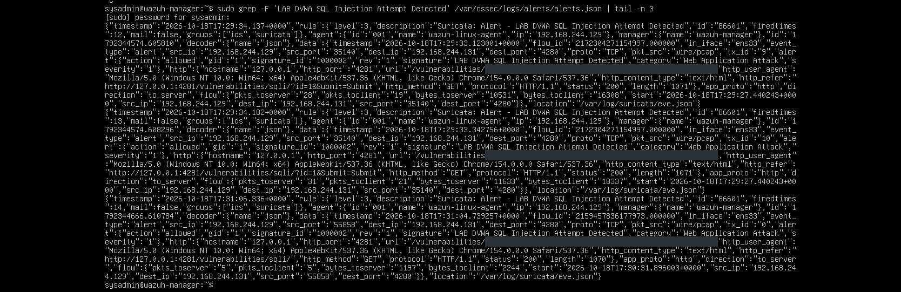

[Open full-resolution copy](sqli/E33-2026-10-18-103902.png)

## E36 — Screenshot 2026-10-18 121122.png

TheHive API status responses coexist with a zero-server Cortex quota warning; new Week 8 case/enrichment success is unverified.

Redaction: No sensitive values identified in selected frame.

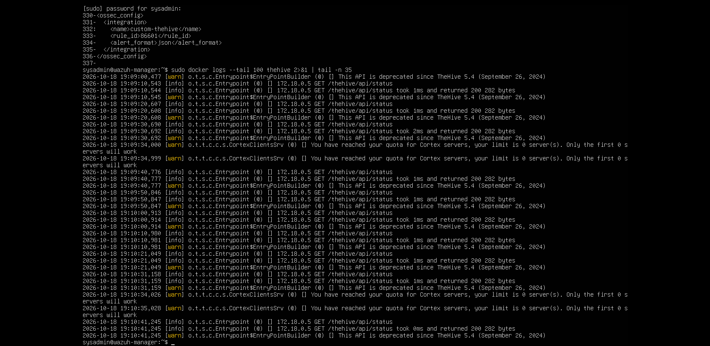

[Open full-resolution copy](case-management/E36-2026-10-18-121122.png)

## E37 — Screenshot 2026-10-19 004231.png

Shuffle frontend HTTP 200 and local port connectivity succeed; webhook delivery remains a separate test.

Redaction: No sensitive values identified in selected frame.

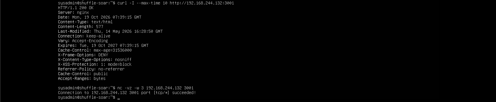

[Open full-resolution copy](shuffle/E37-2026-10-19-004231.png)

## E38 — Screenshot 2026-10-19 005049.png

Extensionless shuffle launcher initially missing while shuffle.py exists.

Redaction: No sensitive values identified in selected frame.

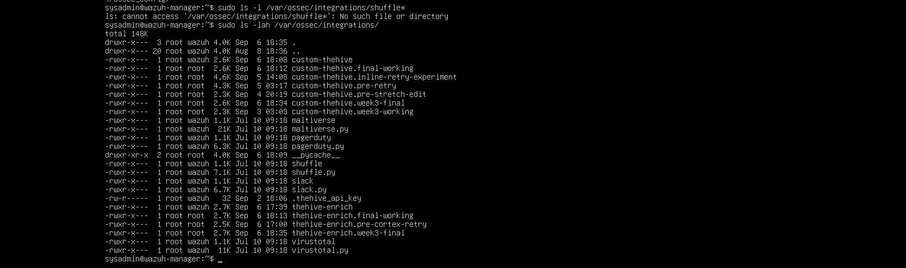

[Open full-resolution copy](troubleshooting/E38-2026-10-19-005049.png)

## E39 — Screenshot 2026-10-19 071733.png

GitHub Actions run summary: Semgrep fails, pip-audit passes, two artifacts; no direct CI-to-Wazuh delivery proven.

Redaction: No sensitive values identified in selected frame.

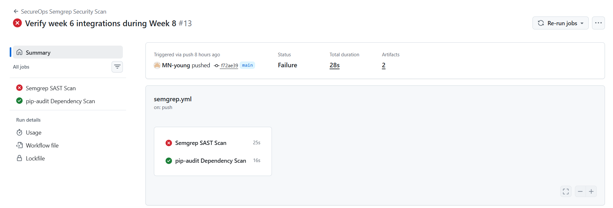

[Open full-resolution copy](week-06-07-validation/E39-2026-10-19-071733.png)

## E42 — Screenshot 2026-10-19 010944.png

Checkov API name resolution fails, while normalized failed-check records are printed below; completeness of that scan is not established.

Redaction: No sensitive values identified in selected frame.

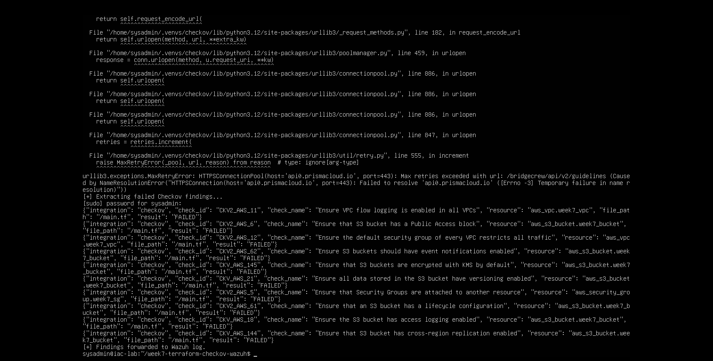

[Open full-resolution copy](week-06-07-validation/E42-2026-10-19-010944.png)

## E43 — Screenshot 2026-10-19 011349.png

Checkov finding reaches Wazuh Rule 110701 Level 12; generic sudo records in the broad query are unrelated.

Redaction: No sensitive values identified in selected frame.

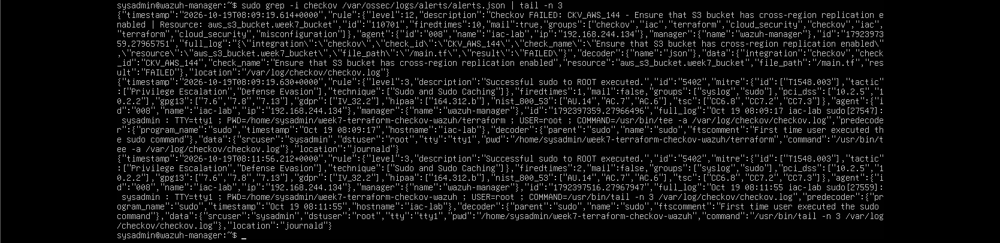

[Open full-resolution copy](week-06-07-validation/E43-2026-10-19-011349.png)

## E45 — Screenshot 2026-10-19 013733.png

Linux Agent collects JSON from /var/log/semgrep/findings.json and /var/log/pip-audit/findings.json.

Redaction: No sensitive values identified in selected frame.

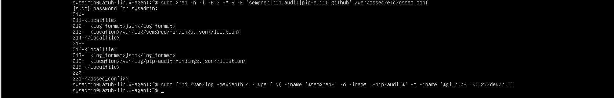

[Open full-resolution copy](week-06-07-validation/E45-2026-10-19-013733.png)

## E47 — Screenshot 2026-10-19 052803.png

Synthetic Semgrep logtest matches Rule 100201 Level 10 despite unrelated missing-list warnings.

Redaction: No sensitive values identified in selected frame.

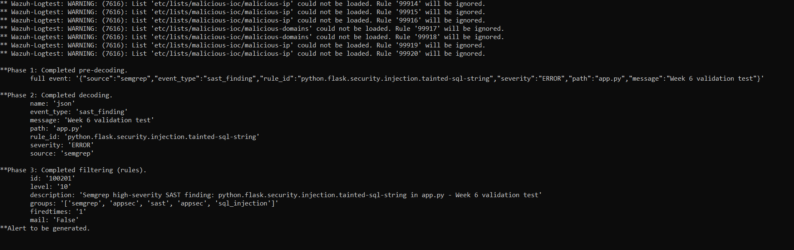

[Open full-resolution copy](week-06-07-validation/E47-2026-10-19-052803.png)

## E48 — Screenshot 2026-10-19 052920.png

Synthetic pip-audit logtest matches Rule 100203 Level 12.

Redaction: No sensitive values identified in selected frame.

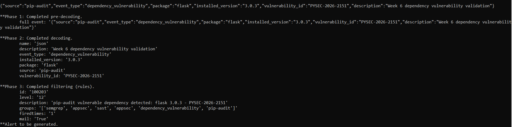

[Open full-resolution copy](week-06-07-validation/E48-2026-10-19-052920.png)

## E49 — Screenshot 2026-10-19 053530.png

Controlled Semgrep test JSON appended to the monitored agent file; not a fresh scanner export.

Redaction: No sensitive values identified in selected frame.

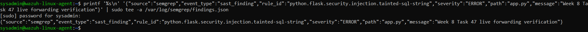

[Open full-resolution copy](week-06-07-validation/E49-2026-10-19-053530.png)

## E50 — Screenshot 2026-10-19 054007.png

Manager live alert for the Semgrep test: Rule 100201 Level 10, marker and agent match.

Redaction: No sensitive values identified in selected frame.

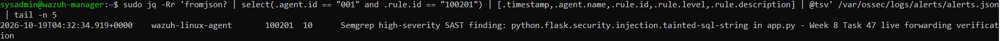

[Open full-resolution copy](week-06-07-validation/E50-2026-10-19-054007.png)

## E51 — Screenshot 2026-10-19 054337.png

Controlled pip-audit dependency test JSON appended; vulnerable version is a test payload, not the current CI dependency state.

Redaction: No sensitive values identified in selected frame.

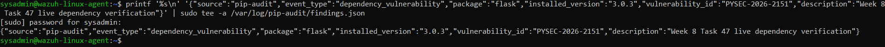

[Open full-resolution copy](week-06-07-validation/E51-2026-10-19-054337.png)

## E52 — Screenshot 2026-10-19 054416.png

Manager live dependency-test alert: Rule 100203 Level 12.

Redaction: No sensitive values identified in selected frame.

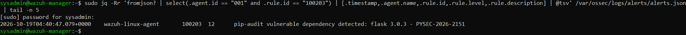

[Open full-resolution copy](week-06-07-validation/E52-2026-10-19-054416.png)

## E53 — Screenshot 2026-10-19 060007.png

Operator uses docker exec -u www-data; su authentication fails with exit 1 and before/after uid remains 33.

Redaction: No sensitive values identified in selected frame.

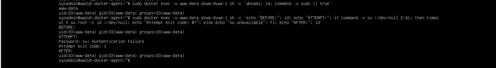

[Open full-resolution copy](privilege-escalation/E53-2026-10-19-060007.png)

## E54 — Screenshot 2026-10-19 064825.png

Dashboard jointly displays Checkov 110701 Level 12, pip-audit 100203 Level 12 and Semgrep 100201 Level 10.

Redaction: No sensitive values identified in selected frame.

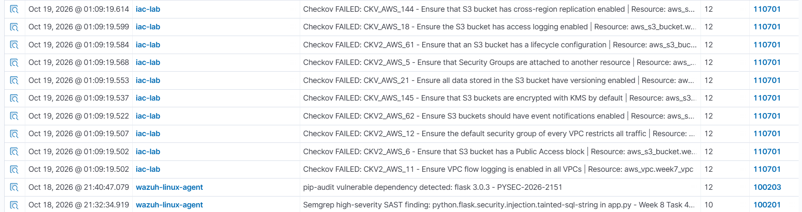

[Open full-resolution copy](week-06-07-validation/E54-2026-10-19-064825.png)

## E58 — Screenshot 2026-10-19 170611.png

Slack notification matches Rule 110750 Level 8 and final manager event timestamp; destination channel reported by handoff, channel label not visible in crop.

Redaction: No sensitive values identified in selected frame.

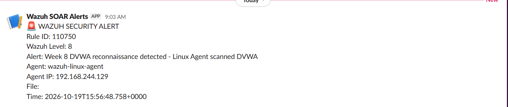

[Open full-resolution copy](slack/E58-2026-10-19-170611.png)

## E59 — Screenshot 2026-10-19 071827.png

Semgrep CI scan: 9 findings, 9 blocking, 341 rules, 11 targets, exit 1; pip-audit job green.

Redaction: No sensitive values identified in selected frame.

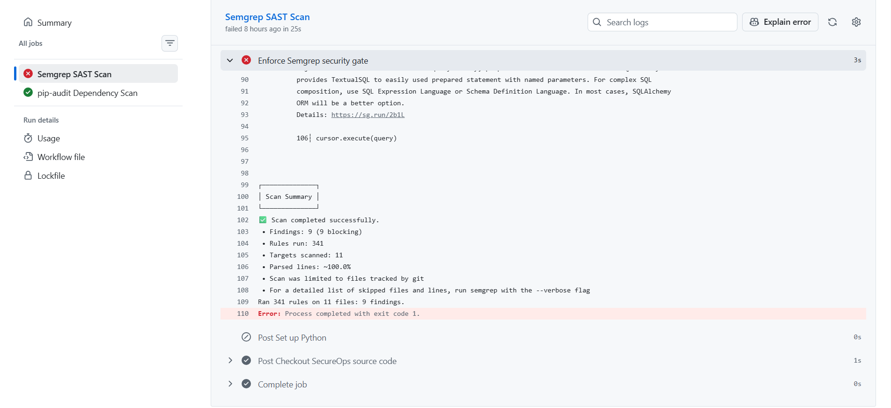

[Open full-resolution copy](week-06-07-validation/E59-2026-10-19-071827.png)

## E60 — Screenshot 2026-10-19 154901.png

Broad grep returns Semgrep and generic Successful sudo to ROOT alerts; these do not establish www-data escalation or detection of its failed su attempt.

Redaction: No sensitive values identified in selected frame.

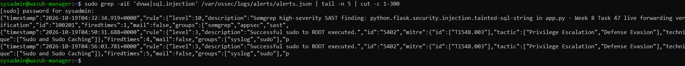

[Open full-resolution copy](privilege-escalation/E60-2026-10-19-154901.png)

## E61 — Screenshot 2026-10-19 160119.png

Manager confirms base Suricata port-scan alert under Rule 86601 for Linux Agent to DVWA.

Redaction: No sensitive values identified in selected frame.

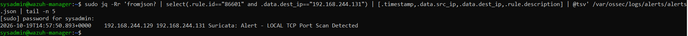

[Open full-resolution copy](reconnaissance/E61-2026-10-19-160119.png)

## E62 — Screenshot 2026-10-19 160806.png

Initial custom Rule 110750 uses data-prefixed fields; later query produces no custom match.

Redaction: No sensitive values identified in selected frame.

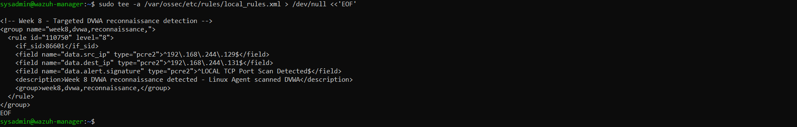

[Open full-resolution copy](troubleshooting/E62-2026-10-19-160806.png)

## E64 — Screenshot 2026-10-19 161402.png

Query for custom Rule 110750 returns no rows at this checkpoint; base detection existed.

Redaction: No sensitive values identified in selected frame.

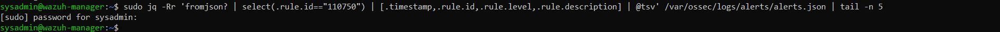

[Open full-resolution copy](troubleshooting/E64-2026-10-19-161402.png)

## E66 — Screenshot 2026-10-19 161928.png

Corrected Rule 110750 uses src_ip, dest_ip and alert.signature; parent 86601, Level 8.

Redaction: No sensitive values identified in selected frame.

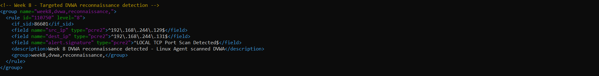

[Open full-resolution copy](wazuh/E66-2026-10-19-161928.png)

## E69 — Screenshot 2026-10-19 165942.png

Final Nmap -sT -Pn -p 1-1000,4280 scan; SSH/22 and DVWA/4280 open.

Redaction: No sensitive values identified in selected frame.

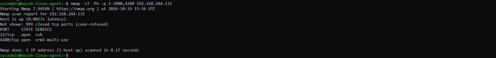

[Open full-resolution copy](reconnaissance/E69-2026-10-19-165942.png)

## E70 — Screenshot 2026-10-19 170043.png

Two custom Rule 110750 Level 8 alerts; final event 15:56:48.758+0000 matches Shuffle and Slack.

Redaction: No sensitive values identified in selected frame.

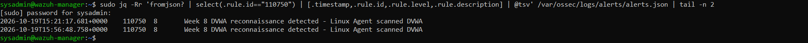

[Open full-resolution copy](wazuh/E70-2026-10-19-170043.png)

## E71 — Screenshot 2026-10-19 170246.png

Final reconnaissance payload in Shuffle, Rule 110750 and matching timestamp; UI status EXECUTING; extra severity 3 origin unresolved.

Redaction: No sensitive values identified in selected frame.

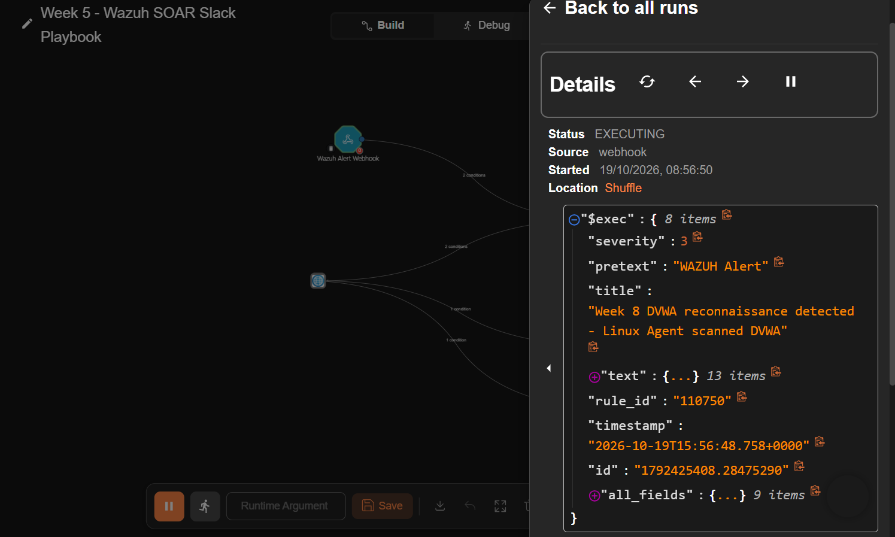

[Open full-resolution copy](shuffle/E71-2026-10-19-170246.png)
